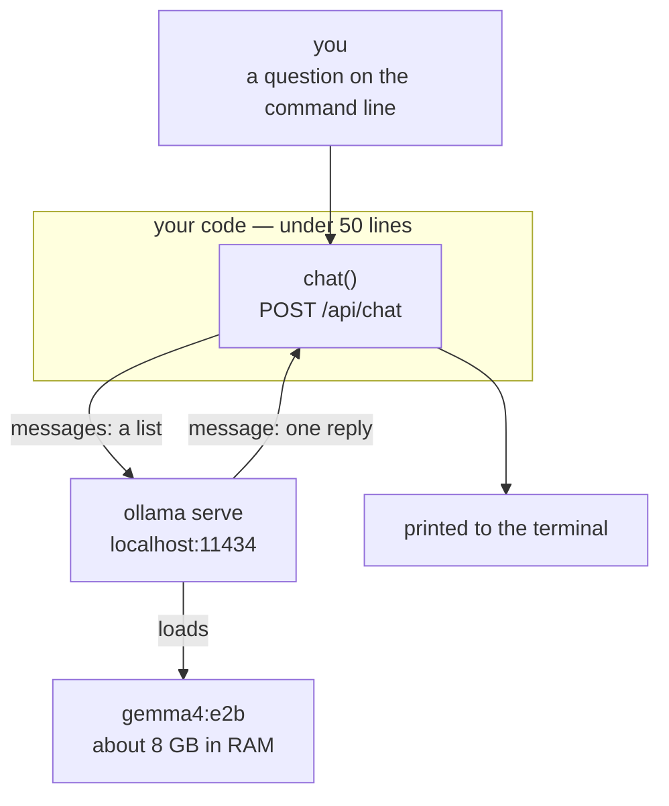

# Chapter 01 — The model

**Video:** about 12 minutes.
**Files:** [`code/ts/src/main.ts`](code/ts/src/main.ts) ·
[`code/csharp/Helper.cs`](code/csharp/Helper.cs) ·
[`code/csharp/Program.cs`](code/csharp/Program.cs)
**Scripts:** [`SCRIPT-ts.md`](SCRIPT-ts.md) · [`SCRIPT-csharp.md`](SCRIPT-csharp.md)
**New words:** [model](../../docs/GLOSSARY.md#model) ·
[endpoint](../../docs/GLOSSARY.md#endpoint) · [local model](../../docs/GLOSSARY.md#local-model) ·
[Ollama](../../docs/GLOSSARY.md#ollama) ·
[message](../../docs/GLOSSARY.md#message) · [role](../../docs/GLOSSARY.md#role) ·
[token](../../docs/GLOSSARY.md#token) · [streaming](../../docs/GLOSSARY.md#streaming)
**New to HTTP or JSON?** Read [`BASICS.md`](BASICS.md) first.

## What we solve

A model is not a program. It is an HTTP endpoint that reads text and writes text.
It cannot open a file. It cannot call an API. It cannot remember you.

Before we build an agent, we prove that. We send one message to a model on this machine and
print what comes back. Under fifty lines, no library.

## Simple example

```bash
cd chapters/01-the-model/code/ts && node src/main.ts "In five words, what is an AI agent?"
# Perceives, reasons, takes action.
```

The C# side asks you instead. Two questions, then an empty line to stop:

```bash
cd chapters/01-the-model/code/csharp && dotnet run
# Type a question. An empty line stops the app.
# You: gemma4:e2b (role: assistant): Perceives, decides, acts, achieves goals.
# You: gemma4:e2b (role: assistant): Perceives, decides, acts.
# You:
```

Two stacks, same endpoint, same model, slightly different wording. The wording changes every
run. A model is not a function — the same input does not give the same output.

The second C# answer is shorter because the question was "And in three?". The model saw turn
one, because the C# side keeps every reply in the list and sends the list back.

## Everyday picture

**The clever stranger behind a door.** You slide a note under the door. A note comes back.
That is all that happens. The stranger has no hands, so they cannot fetch you anything.
They have amnesia, so the next note must repeat the whole story. And they are a guesser, so
two identical notes come back worded differently.

Everything we build in this course is the **outside** of that door. The stranger never changes.

## What this chapter adds



## The one request

This is the whole protocol. Everything else in this course is more of this.

```http
POST http://localhost:11434/api/chat
{
  "model": "gemma4:e2b",
  "stream": false,
  "messages": [ { "role": "user", "content": "In five words, what is an AI agent?" } ]
}
```

And the answer, cut short where it says `...`:

```json
{
  "message": {
    "role": "assistant",
    "content": "Perceives, decides, acts, achieves goals.",
    "thinking": "1.  **Analyze the Request:** The user wants a definition ..."
  },
  "done": true,
  "eval_count": 387,
  "total_duration": 6023645084
}
```

Look at `thinking`. Before it answered, the model wrote about 380
[tokens](../../docs/GLOSSARY.md#token) of notes to itself. That is why five words took six seconds. Our code prints only `content`,
so you never see the notes — but you wait for them. Chapter 01.A puts you in control of this.

Three fields matter.

| Field | Why you care |
|---|---|
| `messages` | a **list**. You send the whole conversation every single time. |
| `stream` | `false` gives one JSON object. `true` drips tokens. Off until chapter 01.A. |
| `message` | one message back, and only ever one |

`role` has three values for now: `system`, `user`, `assistant`. Chapter 04 adds a fourth.

## Why there is no SDK here

An SDK would make this 5 lines instead of 47. We use raw HTTP because the 42 lines it saves
are exactly the 42 lines this course is about. When your agent misbehaves in chapter 05, you
will fix it by reading the request body. You cannot read a body you never wrote.

## TypeScript

Node 24 and up runs `.ts` files directly — no build step, no `tsc`, no watcher.
`fetch` is built in. So: no dependencies at all, and nothing between you and the request.

```bash
cd chapters/01-the-model/code/ts
node src/main.ts "your question here"
```

## C#

Two files. [`Helper.cs`](code/csharp/Helper.cs) is the plumbing — where the model lives, one
HTTP client, one set of JSON options, three records. [`Program.cs`](code/csharp/Program.cs) is
only the conversation, and it reads top to bottom. No dependency injection and no interfaces —
those arrive in chapter 07, when there is something real to inject. `HttpClient` and
`System.Text.Json` are in the box.

It takes no arguments. It asks you, and an empty line stops it.

```bash
cd chapters/01-the-model/code/csharp
dotnet run
```

Three things in the C# files are not obvious:

- **`Timeout = TimeSpan.FromMinutes(5)`.** The default is 100 seconds. A local model loading
  gigabytes into RAM can beat that on the first call, and the error you get looks like a network
  fault instead of a slow disk.
- **`PropertyNamingPolicy = CamelCase`.** Ollama's JSON is lower case, C# properties are not.
  Say it once here, and never think about it again.
- **`messages.Add(reply.Message)`.** The reply goes back into the same list the next question
  goes into, so turn two sees turn one. The server keeps nothing. That list is the memory.

## What differs between the two

Almost nothing, and that is the point of the chapter.

| | TypeScript | C# |
|---|---|---|
| HTTP | `fetch`, built in | `HttpClient`, built in |
| JSON → object | `await response.json()` and a `type` | `ReadFromJsonAsync<T>` and a `record` |
| field names | already match | need one `JsonSerializerOptions` line |
| build step | none | `dotnet run` builds, first run is slow |
| timeout | none by default | 100 s by default — must be raised |
| files | one, `main.ts` | two, `Helper.cs` and `Program.cs` |
| how you ask | one question in the arguments, then it exits | it asks you, until an empty line |
| memory across turns | none — one question, one answer | the reply goes back in the list |

The last two rows are real differences, not style. The C# video builds the terminal loop in
chapter 01 and gets memory across turns for one line. The TypeScript video stays one-shot and
builds its loop in chapter 02. Chapter 11 compares them side by side.

The C# side types the wire. The TypeScript side describes it and hopes. Chapter 11 says which
one that helps, and when.

## When it breaks

| What you see | What it means | What to do |
|---|---|---|
| `ECONNREFUSED` / `Connection refused` | the server is not running | `ollama serve` |
| `model "..." not found` | you did not pull it | `ollama pull gemma4:e2b` |
| the first answer is much slower | the model is loading into RAM | wait. The next one is fast. |
| C# answer is `null` | the JSON names did not match | keep `PropertyNamingPolicy = CamelCase` |

More in [`docs/SETUP.md`](../../docs/SETUP.md#when-it-does-not-work).

## Try it yourself

**TypeScript.** The model remembers nothing. Prove it, then fix it by hand.

1. Ask: `"My name is Sam. Say hi."` Then, in a new run, ask: `"What is my name?"`
   It does not know.
2. Change the code so `messages` holds three items: your first question, the model's answer
   (role `assistant`), and the second question. Run it. Now it knows.

**C#.** You already have that list. So break it, and watch what you lose.

1. Tell it `"My name is Sam. Say hi."`, then ask `"What is my name?"` in the same run.
   It knows.
2. Delete `messages.Add(reply.Message)` from `Program.cs`. Ask the same two questions again.
   It has forgotten, inside one run.
3. Put it back, then ask twelve questions in a row and watch each answer get slower.
   You just found the problem chapter 06 solves.

Both sides end in the same place: short memory is a list you send again, and it is not free.

## Done when

- [ ] `node src/main.ts "hello"` prints a sentence
- [ ] `dotnet run` asks `You:`, answers, and stops on an empty line
- [ ] you stopped `ollama serve` and saw the error each stack gives
- [ ] you can say, without looking, what the three fields in the request body are
