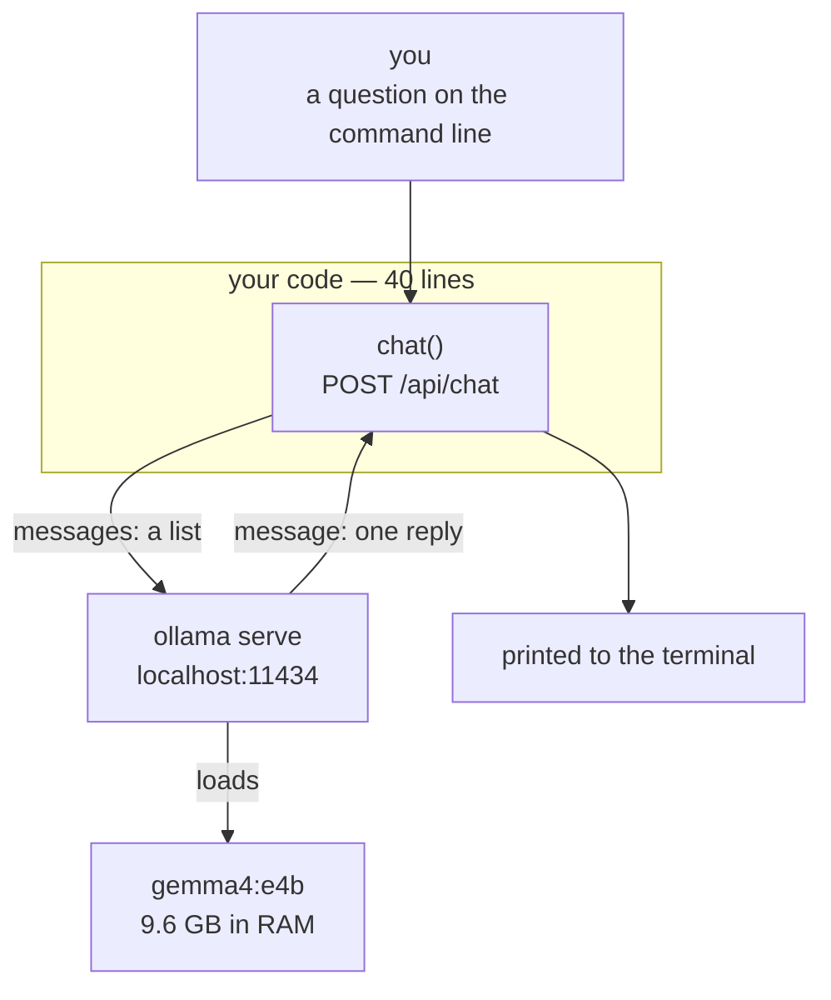

# Chapter 01 — The model

**Video:** about 12 minutes.
**Code at the end of this chapter:** `git checkout ch01-model`
**Files:** [`ts/src/main.ts`](../../ts/src/main.ts) · [`csharp/Program.cs`](../../csharp/Program.cs)
**New words:** [model](../../docs/GLOSSARY.md#model) ·
[endpoint](../../docs/GLOSSARY.md#endpoint) · [local model](../../docs/GLOSSARY.md#local-model) · [Ollama](../../docs/GLOSSARY.md#ollama) ·
[message](../../docs/GLOSSARY.md#message) · [role](../../docs/GLOSSARY.md#role) ·
[token](../../docs/GLOSSARY.md#token) · [streaming](../../docs/GLOSSARY.md#streaming)
**New to HTTP or JSON?** Read [`docs/BASICS.md`](../../docs/BASICS.md) first.

## What we solve

A model is not a program. It is an HTTP endpoint that reads text and writes text.
It cannot open a file. It cannot call an API. It cannot remember you.

Before we build an agent, we prove that. We send one message to a model on this machine and
print what comes back. Forty lines, no library.

## Simple example

```bash
cd ts && node src/main.ts "In five words, what is an AI agent?"
# Autonomous software performing tasks for you.
```

```bash
cd csharp && dotnet run -- "In five words, what is an AI agent?"
# Autonomous entity that thinks, acts.
```

Two stacks, same endpoint, same model, slightly different wording. The wording changes every
run. A model is not a function — the same input does not give the same output.

## Everyday picture

**The clever stranger behind a door.** You slide a note under the door. A note comes back.
That is all that happens. The stranger has no hands, so they cannot fetch you anything.
They have amnesia, so the next note must repeat the whole story. And they are a guesser, so
two identical notes come back worded differently.

Everything we build in this course is the **outside** of that door. The stranger never changes.

## What this chapter adds



## The one request

This is the whole protocol. Everything else in this course is more of this.

```http
POST http://localhost:11434/api/chat
{
  "model": "gemma4:e4b",
  "stream": false,
  "messages": [ { "role": "user", "content": "In five words, what is an AI agent?" } ]
}
```

And the whole answer:

```json
{
  "message": { "role": "assistant", "content": "Autonomous software performing tasks for you." },
  "done": true,
  "eval_count": 15,
  "total_duration": 5587467417
}
```

Three fields matter.

| Field | Why you care |
|---|---|
| `messages` | a **list**. You send the whole conversation every single time. |
| `stream` | `false` gives one JSON object. `true` drips tokens. Off until chapter 06. |
| `message` | one message back, and only ever one |

`role` has three values for now: `system`, `user`, `assistant`. Chapter 04 adds a fourth.

## Why there is no SDK here

An SDK would make this 5 lines instead of 40. We use raw HTTP because the 35 lines it saves
are exactly the 35 lines this course is about. When your agent misbehaves in chapter 05, you
will fix it by reading the request body. You cannot read a body you never wrote.

## TypeScript

Node 24 and up runs `.ts` files directly — no build step, no `tsc`, no watcher.
`fetch` is built in. So: no dependencies at all, and nothing between you and the request.

```bash
cd ts
node src/main.ts "your question here"
```

## C#

One top-level `Program.cs`. No classes, no dependency injection, no interfaces — those arrive
in chapter 07, when there is something real to inject. `HttpClient` and `System.Text.Json`
are in the box.

```bash
cd csharp
dotnet run -- "your question here"
```

Two things in the C# file are not obvious:

- **`Timeout = TimeSpan.FromMinutes(5)`.** The default is 100 seconds. A local model loading
  9.6 GB into RAM can beat that on the first call, and the error you get looks like a network
  fault instead of a slow disk.
- **`PropertyNamingPolicy = CamelCase`.** Ollama's JSON is lower case, C# properties are not.
  Say it once here, and never think about it again.

## What differs between the two

Almost nothing, and that is the point of the chapter.

| | TypeScript | C# |
|---|---|---|
| HTTP | `fetch`, built in | `HttpClient`, built in |
| JSON → object | `await response.json()` and a `type` | `ReadFromJsonAsync<T>` and a `record` |
| field names | already match | need one `JsonSerializerOptions` line |
| build step | none | `dotnet run` builds, first run is slow |
| timeout | none by default | 100 s by default — must be raised |

The C# side types the wire. The TypeScript side describes it and hopes. Chapter 10 says which
one that helps, and when.

## When it breaks

| What you see | What it means | What to do |
|---|---|---|
| `ECONNREFUSED` / `Connection refused` | the server is not running | `ollama serve` |
| `model "..." not found` | you did not pull it | `ollama pull gemma4:e4b` |
| first answer takes 30 seconds | the model is loading into RAM | wait. The next one is fast. |
| C# answer is `null` | the JSON names did not match | keep `PropertyNamingPolicy = CamelCase` |

More in [`docs/SETUP.md`](../../docs/SETUP.md#when-it-does-not-work).

## Try it yourself

The model remembers nothing. Prove it, then fix it by hand.

1. Ask: `"My name is Sam. Say hi."` Then, in a new run, ask: `"What is my name?"`
   It does not know.
2. Change the code so `messages` holds three items: your first question, the model's answer
   (role `assistant`), and the second question. Run it. Now it knows.

You just built short memory. Chapter 06 does it properly.

## Done when

- [ ] `node src/main.ts "hello"` prints a sentence
- [ ] `dotnet run -- "hello"` prints a sentence
- [ ] you stopped `ollama serve` and saw the error each stack gives
- [ ] you can say, without looking, what the three fields in the request body are
