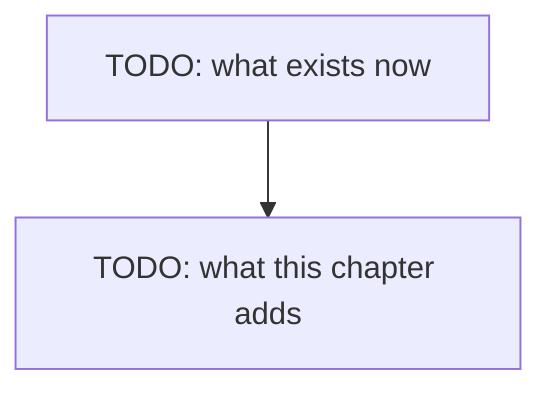

# Chapter 01.A — Thinking

> **Not written yet.** This is the skeleton. See [`docs/PLAN.md`](../../docs/PLAN.md) for where
> this chapter sits, and [`docs/STYLE.md`](../../docs/STYLE.md) for how to fill it in.

**Video:** about 12 minutes.
**Code:** the chapter 01 code, plus about 30 new lines. Where it lives is not final.
**New words:** TODO — link each to [`GLOSSARY.md`](../../docs/GLOSSARY.md)

## What we solve

Our default model thinks before it answers. In chapter 01 a five-word answer cost about 380
tokens of thinking, and we waited for all of it without seeing any. This chapter adds one flag,
`THINK=on|off`, and turns on streaming, so the answer arrives word by word. With thinking on,
you watch the notes appear first, in grey, then the answer. With it off, the answer comes fast.
You decide which one your agent uses.

## Simple example

TODO: one concrete thing the viewer sees happen on screen.

## Everyday picture

TODO: one picture from normal life that carries the idea.

## What this chapter adds

## TypeScript

TODO

## C#

TODO

## What differs between the two

TODO: or "nothing worth a sentence", which is also an answer.

## When it breaks

| What you see | What it means | What to do |
|---|---|---|
| TODO: copied from a real run | | |

## Try it yourself

TODO: one small task, 10-20 minutes, that changes the code.

## Done when

- [ ] TODO
