# Chapter 01.A — Thinking

**Video:** about 12 minutes. Two videos: one TypeScript, one C#.
**Code:** the chapter 01 code, plus about 30 new lines.
**Files:** [`code/ts/src/main.ts`](code/ts/src/main.ts) ·
[`code/csharp/Program.cs`](code/csharp/Program.cs)
**Scripts:** [`SCRIPT-ts.md`](SCRIPT-ts.md) · [`SCRIPT-csharp.md`](SCRIPT-csharp.md)
**New words:** [thinking](../../docs/GLOSSARY.md#thinking) ·
[streaming](../../docs/GLOSSARY.md#streaming) ·
[JSON Lines](../../docs/GLOSSARY.md#json-lines) ·
[environment variable](../../docs/GLOSSARY.md#environment-variable)
**New to streams or environment variables?** Read [`BASICS.md`](BASICS.md) first.

## What we solve

Our default model thinks before it answers. In chapter 01 a five-word answer cost about 380
tokens of thinking, and we waited for all of it without seeing any. This chapter adds one flag,
`THINK=on|off`, and turns on streaming, so the answer arrives word by word. With thinking on,
you watch the notes appear first, in grey, then the answer. With it off, the answer comes fast.
You decide which one your agent uses.

## Simple example

Thinking on. The grey notes stream first, then the answer. The end of a real run:

```bash
cd chapters/01.A-thinking/code/ts && THINK=on node src/main.ts "In five words, what is an AI agent?"
# ... "Perceives, reasons, acts, achieves goals." (This is a strong, functional definition.)
# 7.  **Format the Answer.**
#
# Perceives, reasons, acts, achieves goals.
```

Thinking off. No notes, and the answer is back in under half a second instead of five:

```bash
cd chapters/01.A-thinking/code/ts && THINK=off node src/main.ts "In five words, what is an AI agent?"
# Perceives, reasons, acts autonomously.
```

Measured on this machine: 5.4 s with thinking, 0.4 s without. Same model, same question.
Thinking cost us twelve times the wait for an answer that is no better.

`THINK` unset sends nothing, and the model does what it ships with. `gemma4:e2b` ships with
thinking on.

## Everyday picture

**The scrap paper.** You ask someone for the answer to a sum. They do not speak at once. They
pull a sheet of scrap paper, write the steps down, cross two of them out, and then tell you the
number. The scrap paper is not the answer. It is the work before the answer.

The model does the same thing, and in chapter 01 it did it behind the door where you could not
see it. Now there is a window. You can watch the scrap paper fill, or you can tell them to skip
it and answer from the top of their head. Fast and sometimes wrong, or slow and usually better.

## What this chapter adds

```mermaid
flowchart TD
    YOU["you<br/>a question, plus THINK=on or off"] --> APP
    subgraph app["your code"]
        APP["chat()<br/>POST /api/chat"]
        SPLIT{"which field<br/>is in this line?"}
        GREY["print grey<br/>thinking"]
        PLAIN["print plain<br/>content"]
    end
    APP -->|"stream: true, think: on off or absent"| OLLAMA["ollama serve<br/>localhost:11434"]
    OLLAMA -->|"one JSON object per line"| SPLIT
    SPLIT -->|"thinking"| GREY
    SPLIT -->|"content"| PLAIN
```



Chapter 01 sent `stream: false` and got one JSON object at the end. This chapter sends
`stream: true` and gets a line at a time, so we print as it arrives instead of after.

## The two new fields

```http
POST http://localhost:11434/api/chat
{
  "model": "gemma4:e2b",
  "stream": true,
  "think": true,
  "messages": [ { "role": "user", "content": "In five words, what is an AI agent?" } ]
}
```

| Field | Values | What happens |
|---|---|---|
| `stream` | `true` | one JSON object **per line**, not one at the end |
| `think` | `true` | the model writes notes first, and you get them in a `thinking` field |
| `think` | `false` | no notes. The answer starts at once. |
| `think` | **not sent** | the model does what it ships with. Safe for every model. |

Not sending the field matters. A model that cannot think answers `think: true` with a 400,
not with an answer. So `THINK` unset sends nothing at all.

One line per token. "Say hi in two words." came back as **330 lines** on this machine —
328 of thinking, 2 of answer. The first, the last two, and the very last, cut short:

```json
{"model":"gemma4:e2b","message":{"role":"assistant","content":"","thinking":"Thinking"},"done":false}
{"model":"gemma4:e2b","message":{"role":"assistant","content":"Hi"},"done":false}
{"model":"gemma4:e2b","message":{"role":"assistant","content":" there"},"done":false}
{"model":"gemma4:e2b","message":{"role":"assistant","content":""},"done":true,"done_reason":"stop",
 "eval_count":379,"eval_duration":5317343250}
```

Three things to see. A thinking line has a `thinking` field and an empty `content`. An answer
line has only `content`. And the **last** line is the only one with the counts — `eval_count`
is 379 tokens for an answer of two words.

## TypeScript

Three new pieces. The `THINK` flag, read once at the top. The stream reader, which is a
`for await` over the body. And the line buffer.

```bash
cd chapters/01.A-thinking/code/ts
THINK=on  node src/main.ts "In five words, what is an AI agent?"
THINK=off node src/main.ts "In five words, what is an AI agent?"
```

Two things in the file are not obvious:

- **`JSON.stringify` drops a key whose value is `undefined`.** That is why `THINK` unset means
  no `think` field on the wire, with no `if` anywhere.
- **The `buffer` variable.** A network chunk can stop in the middle of a line. We split on
  `\n`, keep the last piece — which may be half a line — and glue the next chunk onto it.
  Without this, one `JSON.parse` in ten throws.

## C#

The same three pieces, in C# shapes.

```bash
cd chapters/01.A-thinking/code/csharp
THINK=on  dotnet run -- "In five words, what is an AI agent?"
THINK=off dotnet run -- "In five words, what is an AI agent?"
```

Two things in the file are not obvious:

- **`HttpCompletionOption.ResponseHeadersRead`.** Without it, `HttpClient` waits for the whole
  body before it gives you anything, and your stream is not a stream. The code runs, the output
  looks right, and nothing appears until the end. It is the one line that makes streaming real.
- **`DefaultIgnoreCondition = WhenWritingNull`.** This is what makes `Think = null` mean
  "not on the wire" instead of `"think": null`.

## What differs between the two

| | TypeScript | C# |
|---|---|---|
| read the stream | `for await` over chunks of text | `StreamReader.ReadLineAsync` |
| half a line | **your problem** — the `buffer` variable | handled. `ReadLineAsync` waits for a whole line. |
| drop an unset field | free. `JSON.stringify` skips `undefined`. | one option: `WhenWritingNull` |
| start reading early | free. `fetch` does not wait. | one flag: `ResponseHeadersRead` |

Each side pays for the other's free thing. TypeScript gives you bytes and makes you find the
lines. C# gives you lines and makes you ask for the bytes early.

## When it breaks

| What you see | What it means | What to do |
|---|---|---|
| `Error: 400 Bad Request: {"error":"\"phi4-mini:3.8b\" does not support thinking"}` | you set `THINK=on` for a model that cannot think | leave `THINK` unset, or use `gemma4:e2b` |
| `SyntaxError: Unexpected end of JSON input` | you parsed a half line. The `buffer` is missing or wrong. | keep the `lines.pop()` line |
| nothing prints, then everything at once (C#) | `ResponseHeadersRead` is missing | add it to `http.SendAsync` |
| grey text stays grey after the program ends | the reset code never printed | end every grey write with `\x1b[0m` |

## Try it yourself

Thinking is not free, so measure it before you keep it.

1. Count the tokens. The last streamed line has an `eval_count` field. Print it, with
   thinking on and with thinking off, for the same question. Write both numbers down.
2. Ask a question where thinking should help: `"A shirt costs 23. I pay with 50 and a 2 coin.
   What change do I get?"` Run it both ways, five times each.
3. Decide. Does the slow answer beat the fast one often enough to pay for the wait?

There is no right answer in this repo. It depends on your model and your question. That is the
point — you now have the flag, so you can ask.

## Done when

- [ ] `THINK=on node src/main.ts "hello"` prints grey notes, then an answer
- [ ] `THINK=off` prints only the answer, and is clearly faster
- [ ] both stacks do the same thing
- [ ] you ran `MODEL=phi4-mini:3.8b THINK=on` and saw the 400
- [ ] you can say what breaks if you delete the `buffer` line (TS) or `ResponseHeadersRead` (C#)
