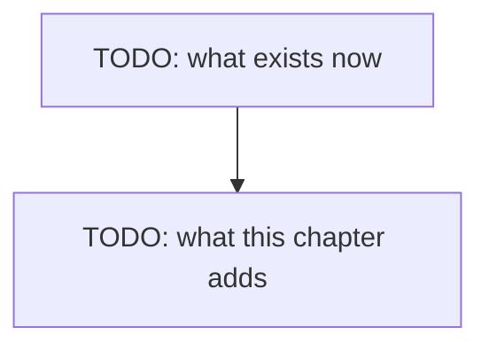

# Chapter 01.A — Thinking

> **Not written yet.** This is the skeleton. See [`docs/PLAN.md`](../../docs/PLAN.md) for where
> this chapter sits, and [`docs/STYLE.md`](../../docs/STYLE.md) for how to fill it in.

**Video:** about 12 minutes.
**Code:** the chapter 01 code, plus about 30 new lines. Where it lives is not final.
**Files:** [`ts/src/main.ts`](../../ts/src/main.ts) · [`csharp/Program.cs`](../../csharp/Program.cs)
**New words:** [thinking](../../docs/GLOSSARY.md#thinking) ·
[streaming](../../docs/GLOSSARY.md#streaming)

## What we solve

Our default model thinks before it answers. In chapter 01 a five-word answer cost about 380
tokens of thinking, and we waited for all of it without seeing any. This chapter adds one flag,
`THINK=on|off`, and turns on streaming, so the answer arrives word by word. With thinking on,
you watch the notes appear first, in grey, then the answer. With it off, the answer comes fast.
You decide which one your agent uses.

## Simple example

Thinking on. The grey notes stream first, then the answer. The end of a real run:

```bash
cd ts && THINK=on node src/main.ts "In five words, what is an AI agent?"
# ... "Perceives, reasons, acts, achieves goals." (Five words. Describes the core mechanism.)
#
# Perceives, reasons, acts, achieves goals.
```

Thinking off. No notes, and the answer is back in half a second instead of six:

```bash
cd ts && THINK=off node src/main.ts "In five words, what is an AI agent?"
# Perceives, reasons, acts autonomously.
```

`THINK` unset sends nothing, and the model does what it ships with. `gemma4:e2b` ships with
thinking on.

## Everyday picture

TODO: one picture from normal life that carries the idea.

## What this chapter adds



## TypeScript

TODO

## C#

TODO

## What differs between the two

TODO: or "nothing worth a sentence", which is also an answer.

## When it breaks

| What you see | What it means | What to do |
|---|---|---|
| `400 Bad Request: {"error":"\"phi4-mini:3.8b\" does not support thinking"}` | you set `THINK=on` for a model that cannot think | leave `THINK` unset, or use `gemma4:e2b` |
## Try it yourself

TODO: one small task, 10-20 minutes, that changes the code.

## Done when

- [ ] TODO
