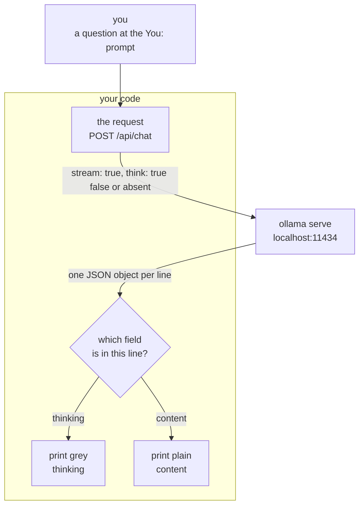

# Chapter 01.A — Thinking

**Video:** about 12 minutes. Two videos: one TypeScript, one C#.
**Code:** the chapter 01 code, plus 44 new lines of C#.
**Files:** [`code/ts/src/main.ts`](code/ts/src/main.ts) ·
[`code/csharp/ChatProtocol.cs`](code/csharp/ChatProtocol.cs) ·
[`code/csharp/Helper.cs`](code/csharp/Helper.cs) ·
[`code/csharp/Program.cs`](code/csharp/Program.cs)
**Scripts:** [`SCRIPT-ts.md`](SCRIPT-ts.md) · [`SCRIPT-csharp.md`](SCRIPT-csharp.md)
**New words:** [thinking](../../docs/GLOSSARY.md#thinking) ·
[streaming](../../docs/GLOSSARY.md#streaming) ·
[JSON Lines](../../docs/GLOSSARY.md#json-lines) ·
[environment variable](../../docs/GLOSSARY.md#environment-variable)
**New to streams, or to a value that can be "not set"?** Read [`BASICS.md`](BASICS.md) first.

## What we solve

Our default model thinks before it answers. In chapter 01 a five-word answer cost about 380
tokens of thinking, and we waited for all of it without seeing any. This chapter does two
things. It turns on [streaming](../../docs/GLOSSARY.md#streaming), so the words arrive one at a
time instead of all at the end. And it gives you one switch for the thinking itself: watch the
notes appear first, in grey, or skip them and get the answer fast. You decide which one your
agent uses.

The switch is one line in your own code, not a flag on the command. You pick it once per
project, not once per run.

## Simple example

Thinking on. The grey notes stream first, then the answer. The end of a real run:

```bash
cd chapters/01.A-thinking/code/csharp && dotnet run
# You: In five words, what is an AI agent?
# gemma4:e2b: 1.  **Analyze the Request:** The user wants a five-word definition ...
# ... 7.  **Select the most accurate and standard description:** Option C best captures
#     the functional loop.
#
# Perceives, reasons, acts, achieves goals.
```

Thinking off — one word changed in [`code/csharp/Helper.cs`](code/csharp/Helper.cs):

```csharp
public static readonly bool? Think = false;
```

```bash
cd chapters/01.A-thinking/code/csharp && dotnet run
# You: In five words, what is an AI agent?
# gemma4:e2b: Autonomous decision-making intelligent software.
```

Measured on this machine: **6.2 s** with thinking, **1.5 s** without, both including the half
second `dotnet run` costs. Same model, same question. Thinking cost four times the wait for an
answer that is no better.

`Think = null` sends nothing at all, and the model does what it ships with. `gemma4:e2b` ships
with thinking on.

## Everyday picture

**The scrap paper.** You ask someone for the answer to a sum. They do not speak at once. They
pull a sheet of scrap paper, write the steps down, cross two of them out, and then tell you the
number. The scrap paper is not the answer. It is the work before the answer.

The model does the same thing, and in chapter 01 it did it behind the door where you could not
see it. Now there is a window. You can watch the scrap paper fill, or you can tell them to skip
it and answer from the top of their head. Fast and sometimes wrong, or slow and usually better.

## What this chapter adds



Chapter 01 sent `stream: false` and got one JSON object at the end. This chapter sends
`stream: true` and gets a line at a time, so we print as it arrives instead of after.

## The two new fields

```http
POST http://localhost:11434/api/chat
{
  "model": "gemma4:e2b",
  "stream": true,
  "think": true,
  "messages": [ { "role": "user", "content": "In five words, what is an AI agent?" } ]
}
```

| Field | Values | What happens |
|---|---|---|
| `stream` | `true` | one JSON object **per line**, not one at the end |
| `think` | `true` | the model writes notes first, and you get them in a `thinking` field |
| `think` | `false` | no notes. The answer starts at once. |
| `think` | **not sent** | the model does what it ships with. Safe for every model. |

Not sending the field matters. A model that cannot think answers `think: true` with a 400,
not with an answer. So the switch is a `bool?`, and `null` means the field never goes on the
wire. Measured by curl on this machine: no field gives 714 characters of thinking,
`"think": null` gives none at all. `null` and absent are **not** the same thing.

One line per token. "Say hi in two words." came back as **330 lines** on this machine —
328 of thinking, 2 of answer. The first, the last two, and the very last, cut short:

```json
{"model":"gemma4:e2b","message":{"role":"assistant","content":"","thinking":"Thinking"},"done":false}
{"model":"gemma4:e2b","message":{"role":"assistant","content":"Hi"},"done":false}
{"model":"gemma4:e2b","message":{"role":"assistant","content":" there"},"done":false}
{"model":"gemma4:e2b","message":{"role":"assistant","content":""},"done":true,"done_reason":"stop",
 "eval_count":379,"eval_duration":5317343250}
```

Three things to see. A thinking line has a `thinking` field and an empty `content`. An answer
line has only `content`. And the **last** line is the only one with the counts — `eval_count`
is 379 tokens for an answer of two words.

## TypeScript

> **Not in step with the C# side yet.** The TypeScript code still reads a `THINK=on|off`
> environment variable instead of a line in the file, and it is still one file. It is brought
> in line in the TypeScript pass — see the To do list in
> [`docs/PROGRESS.md`](../../docs/PROGRESS.md).

Three new pieces. The `THINK` flag, read once at the top. The stream reader, which is a
`for await` over the body. And the line buffer.

```bash
cd chapters/01.A-thinking/code/ts
THINK=on  node src/main.ts "In five words, what is an AI agent?"
THINK=off node src/main.ts "In five words, what is an AI agent?"
```

Two things in the file are not obvious:

- **`JSON.stringify` drops a key whose value is `undefined`.** That is why an unset switch
  means no `think` field on the wire, with no `if` anywhere.
- **The `buffer` variable.** A network chunk can stop in the middle of a line. We split on
  `\n`, keep the last piece — which may be half a line — and glue the next chunk onto it.
  Without this, one `JSON.parse` in ten throws.

## C#

**Three files now, not two.** The conversation barely changes. The plumbing does the new work.

| File | What is in it | What this chapter does to it |
|---|---|---|
| [`ChatProtocol.cs`](code/csharp/ChatProtocol.cs) | the three records, and nothing else | **new file.** The records move out of `Helper.cs`, and two of them gain a field. |
| [`Helper.cs`](code/csharp/Helper.cs) | the plumbing | gains the `Think` switch, two colour codes, and two methods: `HandleStream` and `HandleResponseError` |
| [`Program.cs`](code/csharp/Program.cs) | the conversation, and nothing else | one `PostAsJsonAsync` call becomes a stream, then two calls into `Helper` |

The split is the reason `Program.cs` is still 53 lines and still reads top to bottom: send,
check, stream, remember. Chapter 04 adds tools on top of that, and it has room because reading
a stream is not in the way.

```bash
cd chapters/01.A-thinking/code/csharp
dotnet run
```

Then type a question. An empty line stops it. To turn thinking off, change one word in
`Helper.cs`:

```csharp
public static readonly bool? Think = false;    // true, false, or null for "do not ask"
```

Three things in the files are not obvious:

- **`HttpCompletionOption.ResponseHeadersRead`.** Without it, `HttpClient` waits for the whole
  body before it gives you anything, and your stream is not a stream. The code runs, the output
  looks right, and nothing appears until the end. It is the one line that makes streaming real.
- **`DefaultIgnoreCondition = WhenWritingNull`.** This is what makes `Think = null` mean
  "not on the wire" instead of `"think": null`.
- **Two `StringBuilder`s, not one.** You print each piece as it arrives, but the message list
  needs the finished message. Printing and remembering are two jobs. `HandleStream` takes both
  builders from the caller for the same reason: it prints, the caller remembers.

## What differs between the two

| | TypeScript | C# |
|---|---|---|
| read the stream | `for await` over chunks of text | `StreamReader.ReadLineAsync` |
| half a line | **your problem** — the `buffer` variable | handled. `ReadLineAsync` waits for a whole line. |
| drop an unset field | free. `JSON.stringify` skips `undefined`. | one option: `WhenWritingNull` |
| start reading early | free. `fetch` does not wait. | one flag: `ResponseHeadersRead` |

Each side pays for the other's free thing. TypeScript gives you bytes and makes you find the
lines. C# gives you lines and makes you ask for the bytes early.

## When it breaks

| What you see | What it means | What to do |
|---|---|---|
| `400 Bad Request: {"error":"\"phi4-mini:3.8b\" does not support thinking"}` | you asked for thinking on a model that cannot think | set `Think = null`, or use `gemma4:e2b` |
| `404 Not Found: {"error":"model 'nope:1b' not found"}` | the model name is wrong, or it is not pulled | `ollama pull <name>`, and check `ollama list` |
| nothing prints, then everything at once (C#) | `ResponseHeadersRead` is missing | add it to `http.SendAsync` |
| `SyntaxError: Unexpected end of JSON input` (TS) | you parsed a half line. The `buffer` is missing or wrong. | keep the `lines.pop()` line |
| grey text stays grey after the program ends | the reset code never printed | end every grey write with `\x1b[0m` |

Every error above is copied from a real run on this machine.

## Try it yourself

Thinking is not free, so measure it before you keep it.

1. Count the tokens. The last streamed line has an `eval_count` field. Print it, with
   thinking on and with thinking off, for the same question. Write both numbers down.
2. Ask a question where thinking should help: `"A shirt costs 23. I pay with 50 and a 2 coin.
   What change do I get?"` Run it both ways, five times each.
3. Decide. Does the slow answer beat the fast one often enough to pay for the wait?

There is no right answer in this repo. It depends on your model and your question. That is the
point — you now own the switch, so you can ask.

## Done when

- [ ] `dotnet run` with `Think = true` prints grey notes, then an answer
- [ ] `Think = false` prints only the answer, and is clearly faster
- [ ] the second question in one run gets a shorter answer than the first, because the list is
      the memory
- [ ] both stacks do the same thing
- [ ] you ran `MODEL=phi4-mini:3.8b` with `Think = true` and saw the 400
- [ ] you can say what breaks if you delete `ResponseHeadersRead` (C#) or the `buffer` line (TS)
- [ ] you can say why `ChatProtocol.cs` is its own file and not the bottom of `Helper.cs`
