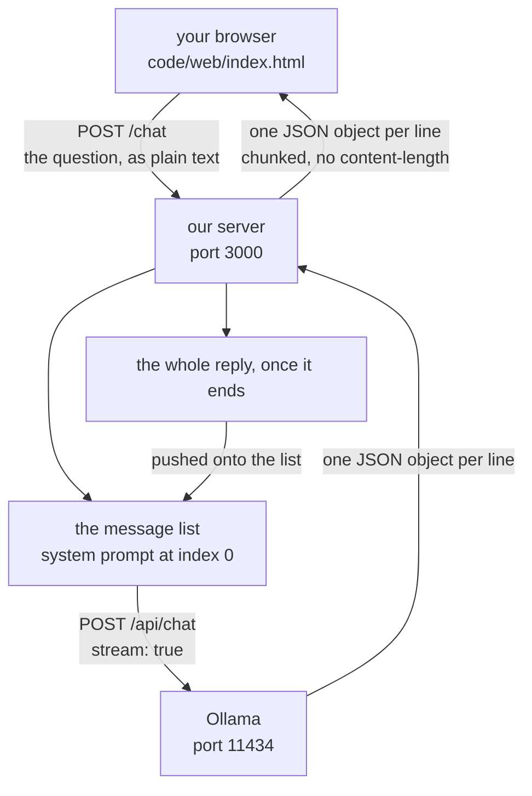

# Chapter 03 — The chat page

**Video:** about 12 minutes. Two videos: one TypeScript, one C#.
**Code:** the chapter 02 code, plus 41 new lines in TypeScript and 65 in C#.
**Files:** [`code/ts/src/main.ts`](code/ts/src/main.ts) ·
[`code/csharp/Program.cs`](code/csharp/Program.cs) ·
[`code/web/index.html`](code/web/index.html) ·
[`code/prompts/`](code/prompts/)
**Scripts:** [`SCRIPT-ts.md`](SCRIPT-ts.md) · [`SCRIPT-csharp.md`](SCRIPT-csharp.md)
**New words:** [HTTP](../../docs/GLOSSARY.md#http) ·
[port](../../docs/GLOSSARY.md#port) ·
[localhost](../../docs/GLOSSARY.md#localhost) ·
[chunked](../../docs/GLOSSARY.md#chunked)
**New to web pages or servers?** Read [`BASICS.md`](BASICS.md) first.

## What we solve

The terminal works. It is also a bad place to watch an agent. Thinking scrolls past, you cannot
scroll back without losing the prompt, and from chapter 04 on there will be tool calls to read
as well. Nobody wants to show that to a colleague.

So we give the agent a window. One HTML page, one `POST /chat` [endpoint](../../docs/GLOSSARY.md#endpoint),
served by the same process that calls the model. The page is given to you in this repo. The
server is the lesson, because the server is where every later chapter lands.

The page is not a seventh part of an agent. It is a window onto the loop we build next.

## Simple example

Run it with no question. It no longer asks you anything — it listens:

```bash
cd chapters/03-the-chat-page/code/ts && node src/main.ts
# Repo Librarian on http://localhost:3000
```

Open that address and ask something. To see what the browser actually receives, ask with curl
instead. Each line is one small [JSON](../../docs/GLOSSARY.md#json) object, and they arrive one
at a time:

```bash
curl -s -N -X POST http://localhost:3000/chat -d "Which file starts the HTTP server?"
# {"role":"assistant","content":"I"}
# {"role":"assistant","content":" cannot"}
# {"role":"assistant","content":" see"}
# {"role":"assistant","content":" the"}
# {"role":"assistant","content":" files"}
# {"role":"assistant","content":" yet"}
# {"role":"assistant","content":"."}
# {"role":"assistant","content":""}
```

The answer is still "I cannot see the files yet", because the agent still has no tools. That is
the point. The window is ready and the agent is blind. Chapter 04 gives it eyes.

Ask a second question and the history holds, exactly as it did in the terminal:

```bash
curl -s -X POST http://localhost:3000/chat -d "What did I just ask you?"
# You asked which file starts the HTTP server.
```

### What streaming is worth

Measured on an M1 Pro, `gemma4:e2b`, `THINK=on`, two runs:

| | Run 1 | Run 2 |
|---|---|---|
| first words on the page | 204 ms | 267 ms |
| answer finished | 6.2 s | 3.9 s |
| lines in the stream | 387 | 240 |

Without [streaming](../../docs/GLOSSARY.md#streaming) the viewer stares at a blank page for the
whole 4 to 6 seconds. With it, words appear in a fifth of a second. The wait did not get
shorter. It stopped feeling like a wait.

## Everyday picture

**The coffee shop counter.** Two shops, both take four minutes to make your drink.

In the first you order through a hatch and the hatch closes. You stand there. Four minutes is
a long time, and twice you wonder whether they forgot you.

In the second you order at a counter and watch the cup being made. The same four minutes.
Nobody checks their watch, because they can see it is working.

Your terminal is the hatch. This chapter builds the counter. The model did not get faster.

## What this chapter adds



The middle three boxes are chapter 02's code, unchanged. What is new is a server in front of it,
and a browser in front of that.

## Two servers, two ports

This is the part that confuses people, so say it plainly. There are now **two** HTTP servers on
your machine, and they are not the same thing.

| | Who wrote it | [Port](../../docs/GLOSSARY.md#port) | What it serves |
|---|---|---|---|
| Ollama | somebody else | 11434 | the model, at `POST /api/chat` |
| ours | you, in this chapter | 3000 | the page, and `POST /chat` |

Our server is a **client** of Ollama's. The browser never talks to Ollama. It talks to us, we
talk to the model, and we pass the words back. Three programs in a row.

That is not plumbing for its own sake. It is the only place the agent's loop can live. The
browser cannot hold the message list — close the tab and it is gone. From chapter 04 on, the
tools run in this process too, because tools read your files and a browser cannot.

## The one change that made it possible

Chapter 02's `chat` printed to the terminal itself. It had `process.stdout.write` inside it. So
it could only ever feed a terminal.

We take that out and pass it in instead:

```ts
// before, chapter 02
async function chat(messages: Message[]): Promise<Message>

// after, chapter 03
async function chat(messages: Message[], send: (part: Message) => void): Promise<Message>
```

Now `chat` does one job: talk to the model and hand over each piece as it arrives. Where the
pieces go is the caller's business. There are two callers, so there are two `send` functions:

- `toTerminal` — thinking in grey, a blank line, then the answer. This is chapter 02's code,
  moved out of `chat` and given a name.
- the one inside the server — `res.write(JSON.stringify(part) + "\n")`.

One function, two windows. That is the whole refactor, and it is four lines. It also means
chapter 05's loop will not have to touch `chat` at all.

## Why the page gets JSON Lines and not plain text

We could write the raw words into the response and let the page show them. Then the page could
not tell thinking from an answer, and both would land in the same grey blob.

So we send [JSON Lines](../../docs/GLOSSARY.md#json-lines) — one small JSON object per line,
the same shape Ollama sends us:

```text
{"role":"assistant","thinking":"The user wants to know which file"}
{"role":"assistant","content":"I"}
{"role":"assistant","content":" cannot"}
```

The page reads a line, looks at the keys, and puts `thinking` in the grey box and `content` in
the answer. Two fields, two places on screen.

Two details make that work:

- **No `content-length` header.** We do not know how long the answer is, because the model has
  not finished writing it. Both stacks then fall back to
  [chunked](../../docs/GLOSSARY.md#chunked) encoding, which is what lets the browser read the
  first word before the last one is written. You can see it in the response headers:
  `Transfer-Encoding: chunked`.
- **A line can arrive in two pieces.** The network splits the body wherever it likes, and that
  may be in the middle of a line. So the page keeps the unfinished tail in a buffer until the
  rest turns up — the same trick the server already uses on Ollama's stream, written twice
  because it happens twice.

## One request at a time, one history for everybody

Two honest limits, both on purpose.

**One history.** The message list is one list for the whole process. Open the page in two tabs
and both tabs share it — tab two can read what tab one asked. That is wrong for a real app and
right for this chapter: there is exactly one agent, and you can watch its whole memory in one
place. Chapter 06 gives each conversation its own.

**One request at a time.** The C# version handles requests in a plain `while` loop, so a second
question waits for the first. The TypeScript version starts both at once, and that goes wrong in
a way worth seeing. Two curls fired together, against the TypeScript server:

```bash
curl -s -X POST http://localhost:3000/chat -d "Say the word RED and nothing else."  &
curl -s -X POST http://localhost:3000/chat -d "Say the word BLUE and nothing else." &
# RED
# RED
```

Both callers got `RED`. Both handlers pushed their question onto the same list, and both then
sent that list — so the second call asked the model two questions and the model answered the
first one. The same pair against the C# server returns `RED` and `BLUE`, because the second
request waited.

Neither is production code. There is one model and one list, so a second question has nothing
of its own to run on. Chapter 06 is where a list stops being one list.

## The terminal loop is gone

Chapter 02's `you>` loop is deleted. The page replaces it, and keeping both would mean three
modes in one file.

A question on the command line still works, and still exits:

```bash
node src/main.ts "Which file starts the HTTP server?"     # one answer, in the terminal
node src/main.ts                                          # no question: the server
```

So every command printed in chapters 01, 01.A and 02 keeps working. Only the no-question case
changed meaning: it used to read lines, and now it listens on a port.

## TypeScript

```bash
cd chapters/03-the-chat-page/code/ts
node src/main.ts                                 # http://localhost:3000
node src/main.ts "one question"                  # one answer in the terminal, then exit
PORT=4000 node src/main.ts                       # a different port
PROMPT=pirate node src/main.ts                   # a pirate, in a browser
```

Four things in the file are not obvious:

- **`node:http` and nothing else.** `createServer` takes one function, and that function gets
  every request: the page, the endpoint, a favicon the browser asks for on its own. There is
  no router and no framework, because there is one page and one endpoint.
- **The handler is `async`, and `for await (const chunk of req)` reads the body.** A request
  body arrives in pieces, exactly like the model's answer does. `req` is an async iterable, so
  the loop that collects it is two lines.
- **`res.writeHead` happens before the model call.** The browser gets its headers at once and
  opens the stream. If you wait for the model first, there is nothing to stream into.
- **One `try` around the model call.** Without it an uncaught throw inside an async handler
  kills the whole process, and the browser gets a closed connection with no message. See
  "When it breaks".

## C#

```bash
cd chapters/03-the-chat-page/code/csharp
dotnet run                                       # http://localhost:3000
dotnet run -- "one question"                     # one answer in the terminal, then exit
PORT=4000 dotnet run                             # a different port
PROMPT=pirate dotnet run                         # a pirate, in a browser
```

Four things in the file are not obvious:

- **`HttpListener`, not a web project.** No NuGet package and no SDK change — the `.csproj` is
  the same console app as chapter 01. It is more code than a minimal API would be, and it
  shows the request and the response as they really are, which is the lesson.
- **The trailing slash in the prefix is not optional.** `http://localhost:3000/` works.
  `http://localhost:3000` throws on `Prefixes.Add`, before you ever reach `Start()`:
  `Only Uri prefixes ending in '/' are allowed.`
- **`SendChunked = true` is what makes it a stream.** Leave it `false` and `HttpListener` sends
  `Content-Length: 0` — it took us at our word that there was nothing to send. The first write
  then throws `Broken pipe` and kills the server. The `Flush()` after each line is belt and
  braces: measured, the chunked stream already pushes each write out without it. It stays in
  the code because it says what we mean.
- **One `try` around the model call.** Without it an uncaught exception kills the listener and
  takes the server with it.

## What differs between the two

| | TypeScript | C# |
|---|---|---|
| make a server | `createServer(handler)` | `new HttpListener()` plus `Prefixes.Add` |
| take a request | the handler is called for you | `await listener.GetContextAsync()` in a loop |
| read the body | `for await (const chunk of req)` | `new StreamReader(request.InputStream)` |
| chunked encoding | automatic when you send no `content-length` | `response.SendChunked = true`, or it sends `Content-Length: 0` |
| write one line out | `res.write(...)` | `OutputStream.Write(...)` |
| which address it binds | `[::]:3000`, every interface | `127.0.0.1:3000`, localhost only |
| two at once | both run, and the shared list corrupts | the second waits for the first |
| the model is down | `TypeError: fetch failed` | `Connection refused (localhost:11434)` |

Two of those rows are real differences, not style.

**The address.** Node binds every interface, so another machine on your network can reach your
agent. `HttpListener` binds localhost only, so nothing outside your machine can. For this
chapter both are fine, and the C# one is the safer default. Chapter 07 is where we care.

**The error message.** C# names the port it could not reach. Node says `fetch failed` and hides
the reason in `error.cause`, so the page shows four useless words. Both mean the same thing:
`ollama serve` is not running.

## When it breaks

| What you see | What it means | What to do |
|---|---|---|
| `Error: listen EADDRINUSE: address already in use :::3000` | another copy of the server is already running | `PORT=4000 node src/main.ts`, or stop the first one |
| `System.Net.HttpListenerException (48): Address already in use` | the same, in C# | `PORT=4000 dotnet run`, or stop the first one |
| `ENOENT: no such file or directory, open '../web/index.html'` | you started it from the wrong folder | `cd` into `code/ts/` first. The path is relative to where you ran it. |
| `System.IO.FileNotFoundException: Could not find file '.../code/web/index.html'` | the same, in C#. It prints the full path it tried. | use `dotnet run` from `code/csharp/` |
| `TypeError: fetch failed` in the page | Ollama is not running. Node hides the real reason. | `ollama serve` |
| `Connection refused (localhost:11434)` in the page | Ollama is not running. C# says so plainly. | `ollama serve` |
| the page loads, but the server died on your first question | you removed the `try` around the model call | put it back. One bad request must not end the process. |
| `System.ArgumentException: Only Uri prefixes ending in '/' are allowed. (Parameter 'uriPrefix')` | your `HttpListener` prefix has no trailing slash | `http://localhost:3000/`, with the slash |
| `HttpListenerException: Unable to write data to the transport connection: Broken pipe.` | `SendChunked` is `false`, so C# sent `Content-Length: 0` and then you wrote anyway | `response.SendChunked = true` before the first write |
| the answer lands all at once, not word by word | in TypeScript, a `content-length` header you added | send no length and let it go chunked |
| two questions at once, and both get the same answer | in TypeScript, both handlers ran against one shared list | ask one at a time. See "One request at a time". |
| the page loads from a `file://` address and asking does nothing | you opened `code/web/index.html` by double-clicking it | open `http://localhost:3000`. A file on disk has no server to POST to. |

## Try it yourself

The page shows the agent's answer. It does not show the agent's memory, and from chapter 04
that memory is where every bug will live.

1. Add `GET /history` to the server. Return the whole message list as JSON. Six lines or so.
2. Open it in a tab next to the chat. Ask three questions, reload it after each, and watch the
   list grow. Count the messages. Work out why the number goes up by two and not one.
3. Now find the leak. Ask twenty questions and look at `/history` again. Nothing removes
   anything, and every turn is re-sent to the model on the next call. Estimate how many
   questions you get before you fill a 4096-token [context window](../../docs/GLOSSARY.md#context-window).

Write your number down. Chapter 06 exists because of it.

## Done when

- [ ] `node src/main.ts` and `dotnet run` both print an address and keep running
- [ ] you asked a question in a browser and watched the words appear one at a time
- [ ] `THINK=on` shows grey thinking in the page, above the answer
- [ ] a second question proves the history held
- [ ] you stopped Ollama, asked again, saw the error **in the page**, and the server survived
- [ ] you can say which of the two servers the browser talks to, and which one it never does
