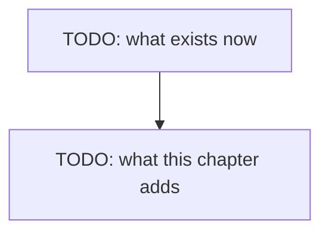

# Chapter 03 — The chat page

> **Not written yet.** This is the skeleton. See [`docs/PLAN.md`](../../docs/PLAN.md) for where
> this chapter sits, and [`docs/STYLE.md`](../../docs/STYLE.md) for how to fill it in.

**Video:** about 12 minutes.
**Code at the end of this chapter:** `git checkout ch03-chat-page`

## What we solve

The terminal works, but it is a poor place to watch an agent think. We serve one HTML page and
one `POST /chat` endpoint from each stack. The page is given. The server is the lesson. From
chapter 04 on, every tool call the agent makes shows up in this page.

## Simple example

TODO: one concrete thing the viewer sees happen on screen.

## Everyday picture

TODO: one picture from normal life that carries the idea.

## What this chapter adds

## TypeScript

TODO

## C#

TODO

## What differs between the two

TODO: or "nothing worth a sentence", which is also an answer.

## Done when

- [ ] TODO
