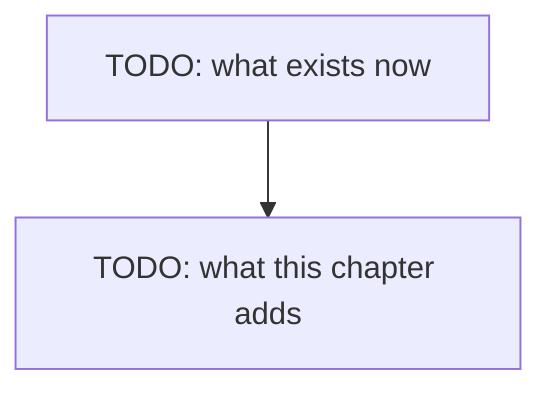

# Chapter 04 — The loop

> **Not written yet.** This is the skeleton. See [`docs/PLAN.md`](../../docs/PLAN.md) for where
> this chapter sits, and [`docs/STYLE.md`](../../docs/STYLE.md) for how to fill it in.

**Video:** about 15 minutes.
**Code at the end of this chapter:** `git checkout 04-TODO-tag`

## What we solve

Send, run the tool, send the result, repeat. This is the whole agent.

## Simple example

TODO: one concrete thing the viewer sees happen on screen.

## Everyday picture

TODO: one picture from normal life that carries the idea.

## What this chapter adds

## TypeScript

TODO

## C#

TODO

## What differs between the two

TODO: or "nothing worth a sentence", which is also an answer.

## Done when

- [ ] TODO
