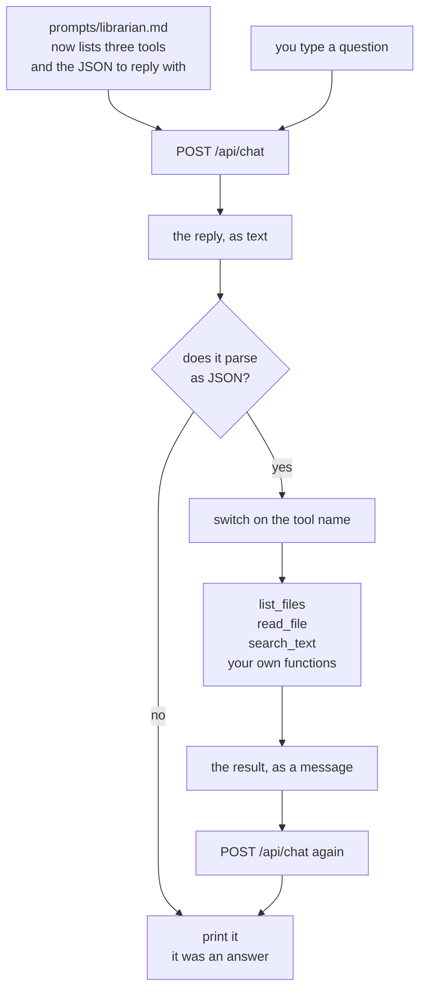

# Chapter 04 — Tools by hand

> **C# is written and run. TypeScript is not.** `code/csharp/` builds, and every C# number and
> every line of output on this page comes from a real run on a real machine. `code/ts/` does
> not exist yet, so the TypeScript section describes the code that gets typed and its file
> links are dead. Both camera scripts are missing.
>
> **The folder the tools read is a stand-in.** [`sample-repo/`](../../sample-repo/) holds one
> file, so the runs below point `REPO` at this repo's own `docs/` folder — six Markdown files,
> real text, no build output. Every example gets rerun against `sample-repo/` once it exists.

**Video:** about 15 minutes. Two videos: one TypeScript, one C#.
**Code at the end of this chapter:** `chapters/04-tools-by-hand/code/`
**Files:** [`code/csharp/Tools.cs`](code/csharp/Tools.cs) ·
[`code/csharp/Program.cs`](code/csharp/Program.cs) ·
[`code/csharp/Helper.cs`](code/csharp/Helper.cs) ·
[`code/csharp/ChatProtocol.cs`](code/csharp/ChatProtocol.cs) ·
[`code/prompts/librarian.md`](code/prompts/librarian.md) · `code/ts/` *(not written)*
**Scripts:** `SCRIPT-ts.md` · `SCRIPT-csharp.md` *(neither written)*
**New words:** [tool](../../docs/GLOSSARY.md#tool) ·
[tool call](../../docs/GLOSSARY.md#tool-call) ·
[tool result](../../docs/GLOSSARY.md#tool-result) ·
[tool schema](../../docs/GLOSSARY.md#tool-schema) ·
[parse](../../docs/GLOSSARY.md#parse) ·
[dispatch](../../docs/GLOSSARY.md#dispatch) ·
[round trip](../../docs/GLOSSARY.md#round-trip)
**New to parsing JSON in code?** Read [`BASICS.md`](BASICS.md) first.

## What we solve

Three chapters in, the agent keeps saying the same sentence: *"I cannot see the files yet."* It
is right. It has no hands. It cannot open a folder, read a line, or look anything up.

This chapter gives it three. And the surprise is how little machinery that takes. There is no
plugin system, no registry, no framework. You write in the
[system prompt](../../docs/GLOSSARY.md#system-prompt): *here are three tools, and to use one,
reply with this JSON.* The model replies with that JSON. Your code reads it, runs a normal
function, and sends the answer back as one more message.

That is the whole thing. A [tool call](../../docs/GLOSSARY.md#tool-call) is a model writing
some text, and your code choosing to act on it. The model runs nothing. It never could.

We do it by hand here, with no help from Ollama, on purpose. Chapter 05 uses the `tools` field
that does some of this for you — and you will see it is the same trick in a nicer wrapper.

## Simple example

One question, and one real run. The grey thinking is left out here.

```bash
cd chapters/04-tools-by-hand/code/csharp
REPO=../../../../docs dotnet run
```

```text
Reading /Users/lk/Projects/BaiGanio/ai-agents-1on1/docs
Type a question. An empty line stops the app.
You: What files are in this folder?
gemma4:e2b: {"tool": "list_files", "path": "."}

[list_files]
GLOSSARY.md
MODELS.md
PLAN.md
PROGRESS.md
SETUP.md
STYLE.md

gemma4:e2b: The files in this folder are GLOSSARY.md, MODELS.md, PLAN.md, PROGRESS.md,
SETUP.md, and STYLE.md. These files seem to cover various aspects, likely relating to
documentation, planning, models, progress tracking, setup procedures, and style guides.
```

9.58 seconds, including `dotnet run`. Read the three blocks in order, because that order is
the chapter.

The model's **whole reply** was `{"tool": "list_files", "path": "."}`. No prose, no apology, no
fence. Thirty-five characters, all of them for your code and none for a human. Nothing had run
yet — the model had **asked**.

`[list_files]` is your code, telling you it decided to believe that text and call a function.

Then the six file names went back as one more message, and the model answered the question it
was asked in the first place.

Two [round trips](../../docs/GLOSSARY.md#round-trip). One function call, written by you, in
between.

The model picks the right tool for the right question, too. All four from real runs:

| You ask | The model replies with |
|---|---|
| `What files are in this folder?` | `{"tool": "list_files", "path": "."}` |
| `What is in STYLE.md?` | `{"tool": "read_file", "path": "STYLE.md"}` |
| `Find every line that contains the word quantisation.` | `{"tool": "search_text", "query": "quantisation"}` |
| `Which file sets the HTTP timeout?` | `{"tool": "list_files", "path": "."}` |

Look at the last row. It is the interesting one. Asked *which file*, the model did not search —
it asked to **look around first**. Nobody told it to. That is the agent loop trying to start,
one chapter early, and chapter 05 is where we let it. This chapter runs one tool and stops, so
the model gets a listing and has to answer from that.

## Everyday picture

**The request slip at a library desk.** You want a book from the closed stacks. You do not walk
in — you are not allowed in. You write the shelf mark on a paper slip, slide it across the desk,
and wait. Someone walks back there and brings the book.

The slip is the tool call. Writing a slip is not fetching a book. A slip with a shelf mark that
does not exist comes back empty, and the slip was still perfectly written.

The model is on the public side of that desk, always. It writes slips. **Your code is the only
thing in the building with legs.** Every rule about what may be fetched is a rule on your side
of the desk, which is why chapter 07 exists.

## What this chapter adds



Three new things. The prompt lists the tools. One `if` asks whether the reply was JSON. And a
second call carries the result back.

## The JSON is a promise the model may break

This is the part nobody warns you about, so it goes near the top.

You asked for JSON in prose. Prose is not a contract. A small model will mostly do it and
sometimes not, and "sometimes" is every day once real people use your agent. Three things it
does instead:

| What it sends back | Why |
|---|---|
| prose, when no tool is needed | you said hello. There is no tool for hello. |
| the JSON inside a markdown code fence | fences are all over its training data, and one looks helpful |
| JSON with a key you never defined | it invented `arguments` or `file`, because other agents use those |

So the parse goes in a `try`, always, and the `catch` is not an error path — **it is the normal
path for a plain answer.** [`BASICS.md`](BASICS.md) has the exact code and the exact error text
in both languages.

Chapter 05's native `tools` field fixes the first two, because the runner enforces the shape
instead of your prose. It does not fix the third.

## The three tools

Ten lines each, in both languages. No dependency.

| Tool | Argument | What it does | What it must not do |
|---|---|---|---|
| `list_files(path)` | a folder | names the files in it, one per line | leave the folder it was given |
| `read_file(path)` | a file | gives back the text | read a 40 MB file into the prompt |
| `search_text(query)` | some text | the lines that contain it, with file and line number | — |

Each one returns a **string**, because a message is a string. If a tool cannot do its job, it
returns a string that says so — `no such file: nope.ts` — and the model reads that and copes.
A tool that throws kills the run. A tool that explains itself is a tool the model can recover
from.

The limits in the last column are **not enforced in this chapter.** `read_file("/etc/passwd")`
works. Say that out loud, be uncomfortable about it, and go to chapter 07.

## TypeScript

**Not written yet.** This is the plan. Two files: `src/tools.ts` holds the three functions and
the dispatch, `src/main.ts` keeps the conversation. `main.ts` has to be split into
`helper.ts` + `main.ts` first, the way chapter 01.A split the C# side.

```bash
cd chapters/04-tools-by-hand/code/ts
node src/main.ts
```

Three things worth stopping on:

- **`JSON.parse` in a `try`, and the `catch` prints the answer.** There is no "is this JSON?"
  function. You try, and failure means it was prose. That reads backwards the first time, and
  it is correct.
- **The dispatch is one `switch`.** `case "list_files": return listFiles(call.path)`. A name
  the model wrote, picking a function you wrote. That is the entire mechanism people call a
  tool registry.
- **`readdir`, `readFile` and a loop over lines.** Node built-ins, nothing installed. The
  search is a `for` loop and `includes`. Ten lines does it, and ten lines is the point.

## C#

Four files. Three come from chapter 02 and one is new.

| File | Lines | What this chapter does to it |
|---|---|---|
| [`Tools.cs`](code/csharp/Tools.cs) | 69 | **new.** The three functions and the dispatch. |
| [`Program.cs`](code/csharp/Program.cs) | 59 | the parse, the dispatch call, the second round trip |
| [`Helper.cs`](code/csharp/Helper.cs) | 123 | gains `RepoRoot` and `Ask` |
| [`ChatProtocol.cs`](code/csharp/ChatProtocol.cs) | 19 | gains the `Call` record |

```bash
cd chapters/04-tools-by-hand/code/csharp
dotnet run                                  # reads ../../../../sample-repo
REPO=../../../../docs dotnet run            # reads any folder you point it at
```

**71 new code lines**, against the ~70 guide in [`PLAN.md`](../../docs/PLAN.md). Five things
worth stopping on:

- **The send moved into `Helper.Ask`.** This chapter sends twice per question, and that block
  was eighteen lines sitting in the middle of `Program.cs`. `Ask` does **not** touch the
  history — the caller appends, so `Program.cs` still shows the memory being built. Chapter 05
  wraps `Ask` in a `while`, and that is the loop.
- **`JsonSerializer.Deserialize` in a `try`, catching `JsonException`.** Catch that type, not
  `Exception`. A `JsonException` means "the model wrote prose". Anything else is a bug in
  `Tools.cs`, and you want it to crash loudly.
- **`record Call(string? Tool, string? Path, string? Query)`, and all three are nullable.**
  `list_files` sends `path` and no `query`. `search_text` sends the other. A model that answers
  `{}` sends neither. One record covers all three tools because the key that was not sent
  arrives as `null`, and `if (call?.Tool is null) continue;` is the only check you need.
- **It is in `ChatProtocol.cs`, with the other records.** `Call` is a wire format too. It is
  just one we invented in a text file instead of one Ollama published.
- **`Directory.EnumerateFiles`, `File.ReadAllText`, `File.ReadLines`.** All base class library.
  No NuGet package, same as every chapter. `Path.GetRelativePath` is why the model gets back
  names it can hand straight to `read_file`.

## What differs between the two

The C# column is from the code. The TypeScript column is the plan, until `code/ts/` exists.

| | TypeScript | C# |
|---|---|---|
| parse | `JSON.parse(text)` | `JsonSerializer.Deserialize<Call>(text, options)` |
| what failure looks like | throws `SyntaxError` | throws `JsonException` |
| a missing key | the property is `undefined` | the property is `null` |
| an extra key you never defined | it is just there on the object | ignored, unless you ask for strict handling |
| list a folder | `await readdir(path, { recursive: true })` | `Directory.EnumerateFiles(path, "*", SearchOption.AllDirectories)` |
| dispatch | `switch (call.tool)` | `switch (call.Tool)` |

One real difference, and it is the third row. TypeScript hands you an object shaped however the
model felt, and a missing `path` is `undefined` until something downstream breaks. C# gives you
a typed `Call` and a `null`, which you can check in one place. Neither one checks the value is
*sensible* — that is chapter 07, in both.

## When it breaks

| What you see | What it means | What to do |
|---|---|---|
| `SyntaxError: Unexpected token 'I', "I am the R"... is not valid JSON` | the model answered in prose. Usually because no tool was needed. | expected. Catch it and print the text as the answer. |
| `System.Text.Json.JsonException: 'I' is an invalid start of a value. Path: $ \| LineNumber: 0 \| BytePositionInLine: 0.` | the same thing, in C# | the same thing: catch `JsonException` and print the text |
| `SyntaxError: Unexpected token`, naming a backtick as the first bad character | the model wrapped the JSON in a markdown code fence | strip the fence lines before you parse, or go to chapter 05. [`BASICS.md`](BASICS.md) has the full error. |
| `System.Text.Json.JsonException`, naming a backtick as an invalid start of a value | the fence, in C# | the same fix |
| `no such folder: .` on every question | `REPO` points at a folder that is not there. `Program.cs` prints the resolved path on the first line — read it. | fix `REPO`, or `cd` to `code/csharp/` first |
| the listing is 36 names and most are `bin/Debug/net10.0/...` | your tools walk every file, and the folder has build output in it. The model then answers about DLLs. | point `REPO` at a folder with no build output, or filter `bin` and `obj` in `ListFiles` |
| `no such file: server.ts` in the tool result, and the agent copes | working as designed. A missing file is a sentence, not a throw. | nothing. This is the row to be pleased about. |
| one question takes 20 seconds instead of 10 | `read_file` sent a whole large file into the prompt. A 42 KB file measured 19.92 s against 9.58 s for a listing. | cap the size in `read_file`, or ask for a search instead. Chapter 07. |
| the model asks for a tool that does not exist | it invented a name, or you renamed one and not the prompt | nothing to fix. The dispatch returns `no such tool: <name>` and the model reads it. |
| the second answer ignores the tool result | you sent the result but not the model's own JSON before it | the list needs both: the `assistant` message that asked, then the result |

## Try it yourself

Add a fourth tool, and find out where "just ask for JSON" runs out.

1. Write `count_lines(path)` — it returns the number of lines in one file. Ten lines of code,
   two edits: the function, and one `case` in the dispatch.
2. Add it to `prompts/librarian.md` in the same shape as the other three. Ask
   *"How long is Helper.cs?"* and see whether the model finds it.
3. Now the real task. Ask for a tool call that needs **two** arguments —
   `search_in_file(path, query)`. Add it, then ask five questions that should use it. Count how
   many times the model sends only one of the two keys.
4. Write down what you did in your code when a key was missing. You have three choices: crash,
   guess a default, or send the model a message saying what it forgot. Pick one and say why.

Number 4 is the chapter's real lesson, and it is not in this repo.

## Done when

- [ ] you asked a question and the model replied with JSON and nothing else
- [ ] your code ran a function because of text a model wrote
- [ ] all three tools have each been picked by the model at least once
- [ ] you said hello, the parse threw, and the agent answered anyway
- [ ] you asked for a file that is not there, and the agent said so instead of crashing
- [ ] you can say why `read_file("/etc/passwd")` works right now, and what chapter fixes it
- [ ] you can say what the model runs when it calls a tool. The answer is nothing.
