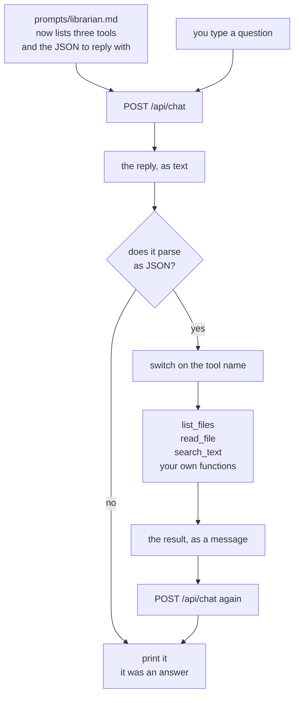

# Chapter 04 — Tools by hand

> **Docs written, code not written yet.** The lesson, the examples and the errors below all
> come from real runs on a real machine — by `curl`, and by two throwaway files for the parse
> errors. The `code/` folder does not exist, so the file links in **Files** are dead until it
> does. The two language sections describe the code that gets typed, in order.
>
> The examples run against `chapters/02-the-prompt/code/` as a **stand-in folder**, because
> [`sample-repo/`](../../sample-repo/) is still empty. Every example on this page gets rerun
> against `sample-repo/` once it exists, and the numbers replaced.

**Video:** about 15 minutes. Two videos: one TypeScript, one C#.
**Code at the end of this chapter:** `chapters/04-tools-by-hand/code/`
**Files:** `code/ts/src/main.ts` · `code/ts/src/tools.ts` ·
`code/csharp/Program.cs` · `code/csharp/Tools.cs` · `code/prompts/librarian.md`
**Scripts:** `SCRIPT-ts.md` · `SCRIPT-csharp.md`
**New words:** [tool](../../docs/GLOSSARY.md#tool) ·
[tool call](../../docs/GLOSSARY.md#tool-call) ·
[tool result](../../docs/GLOSSARY.md#tool-result) ·
[tool schema](../../docs/GLOSSARY.md#tool-schema) ·
[parse](../../docs/GLOSSARY.md#parse) ·
[dispatch](../../docs/GLOSSARY.md#dispatch) ·
[round trip](../../docs/GLOSSARY.md#round-trip)
**New to parsing JSON in code?** Read [`BASICS.md`](BASICS.md) first.

## What we solve

Three chapters in, the agent keeps saying the same sentence: *"I cannot see the files yet."* It
is right. It has no hands. It cannot open a folder, read a line, or look anything up.

This chapter gives it three. And the surprise is how little machinery that takes. There is no
plugin system, no registry, no framework. You write in the
[system prompt](../../docs/GLOSSARY.md#system-prompt): *here are three tools, and to use one,
reply with this JSON.* The model replies with that JSON. Your code reads it, runs a normal
function, and sends the answer back as one more message.

That is the whole thing. A [tool call](../../docs/GLOSSARY.md#tool-call) is a model writing
some text, and your code choosing to act on it. The model runs nothing. It never could.

We do it by hand here, with no help from Ollama, on purpose. Chapter 05 uses the `tools` field
that does some of this for you — and you will see it is the same trick in a nicer wrapper.

## Simple example

Ask the question. Watch the model answer with JSON instead of prose.

```bash
curl -s http://localhost:11434/api/chat -d '{
  "model": "gemma4:e2b", "stream": false, "think": false,
  "messages": [
    {"role":"system","content":"... the three tools, and reply with only JSON ..."},
    {"role":"user","content":"What files are in this folder?"}
  ]
}'
```

The whole of `message.content`, from a real run:

```json
{"tool": "list_files", "path": "."}
```

No prose. No apology. No fence. Thirty-five characters, and every one of them is for your code,
not for a human. Nothing has run yet — the model has **asked**.

Now your code runs `list_files(".")`, gets nine file names, and sends them back as one more
message. The model answers the original question:

```text
There are several files in this folder, including C# files, a .csproj file, and TypeScript
files. The folder also contains prompts in a prompts directory.
```

Two [round trips](../../docs/GLOSSARY.md#round-trip). One function call, written by you, in
between.

The model picks the right tool for the right question, too:

| You ask | The model replies with |
|---|---|
| `What files are in this folder?` | `{"tool": "list_files", "path": "."}` |
| `What is in Helper.cs?` | `{"tool": "read_file", "path": "Helper.cs"}` |
| `Find every line that contains the word Timeout.` | `{"tool": "search_text", "query": "Timeout"}` |
| `Which file sets the HTTP timeout?` | `{"tool": "list_files", "path": "."}` |

Look at the last row. It is the interesting one. Asked *which file*, the model did not search —
it asked to **look around first**. Nobody told it to. That is the agent loop trying to start,
one chapter early, and chapter 05 is where we let it.

## Everyday picture

**The request slip at a library desk.** You want a book from the closed stacks. You do not walk
in — you are not allowed in. You write the shelf mark on a paper slip, slide it across the desk,
and wait. Someone walks back there and brings the book.

The slip is the tool call. Writing a slip is not fetching a book. A slip with a shelf mark that
does not exist comes back empty, and the slip was still perfectly written.

The model is on the public side of that desk, always. It writes slips. **Your code is the only
thing in the building with legs.** Every rule about what may be fetched is a rule on your side
of the desk, which is why chapter 07 exists.

## What this chapter adds



Three new things. The prompt lists the tools. One `if` asks whether the reply was JSON. And a
second call carries the result back.

## The JSON is a promise the model may break

This is the part nobody warns you about, so it goes near the top.

You asked for JSON in prose. Prose is not a contract. A small model will mostly do it and
sometimes not, and "sometimes" is every day once real people use your agent. Three things it
does instead:

| What it sends back | Why |
|---|---|
| prose, when no tool is needed | you said hello. There is no tool for hello. |
| the JSON inside a markdown code fence | fences are all over its training data, and one looks helpful |
| JSON with a key you never defined | it invented `arguments` or `file`, because other agents use those |

So the parse goes in a `try`, always, and the `catch` is not an error path — **it is the normal
path for a plain answer.** [`BASICS.md`](BASICS.md) has the exact code and the exact error text
in both languages.

Chapter 05's native `tools` field fixes the first two, because the runner enforces the shape
instead of your prose. It does not fix the third.

## The three tools

Ten lines each, in both languages. No dependency.

| Tool | Argument | What it does | What it must not do |
|---|---|---|---|
| `list_files(path)` | a folder | names the files in it, one per line | leave the folder it was given |
| `read_file(path)` | a file | gives back the text | read a 40 MB file into the prompt |
| `search_text(query)` | some text | the lines that contain it, with file and line number | — |

Each one returns a **string**, because a message is a string. If a tool cannot do its job, it
returns a string that says so — `no such file: nope.ts` — and the model reads that and copes.
A tool that throws kills the run. A tool that explains itself is a tool the model can recover
from.

The limits in the last column are **not enforced in this chapter.** `read_file("/etc/passwd")`
works. Say that out loud, be uncomfortable about it, and go to chapter 07.

## TypeScript

Two files. [`src/tools.ts`](code/ts/src/tools.ts) holds the three functions and the dispatch.
[`src/main.ts`](code/ts/src/main.ts) keeps the conversation.

```bash
cd chapters/04-tools-by-hand/code/ts
node src/main.ts
```

Three things worth stopping on:

- **`JSON.parse` in a `try`, and the `catch` prints the answer.** There is no "is this JSON?"
  function. You try, and failure means it was prose. That reads backwards the first time, and
  it is correct.
- **The dispatch is one `switch`.** `case "list_files": return listFiles(call.path)`. A name
  the model wrote, picking a function you wrote. That is the entire mechanism people call a
  tool registry.
- **`readdir`, `readFile` and a loop over lines.** Node built-ins, nothing installed. The
  search is a `for` loop and `includes`. Ten lines does it, and ten lines is the point.

## C#

Three files carried over, plus one new. [`Tools.cs`](code/csharp/Tools.cs) holds the three
methods and the dispatch. [`Program.cs`](code/csharp/Program.cs) keeps the conversation.
`Helper.cs` and `ChatProtocol.cs` change very little.

```bash
cd chapters/04-tools-by-hand/code/csharp
dotnet run
```

Three things worth stopping on:

- **`JsonSerializer.Deserialize` in a `try`, catching `JsonException`.** Catch that type, not
  `Exception`. A `JsonException` means "the model wrote prose". Anything else is your bug, and
  you want it to crash loudly.
- **A `record Call(string Tool, string? Path, string? Query)`, and both are nullable.**
  `list_files` sends `path` and no `query`. `search_text` sends the other. One record covers
  all three tools because the unused one arrives as `null`.
- **`Directory.GetFiles`, `File.ReadAllTextAsync`, and `File.ReadLines`.** All in the base
  class library. No NuGet package, same as every chapter.

## What differs between the two

| | TypeScript | C# |
|---|---|---|
| parse | `JSON.parse(text)` | `JsonSerializer.Deserialize<Call>(text, options)` |
| what failure looks like | throws `SyntaxError` | throws `JsonException` |
| a missing key | the property is `undefined` | the property is `null` |
| an extra key you never defined | it is just there on the object | ignored, unless you ask for strict handling |
| list a folder | `await readdir(path)` | `Directory.GetFiles(path)` |
| dispatch | `switch (call.tool)` | `switch (call.Tool)` |

One real difference, and it is the third row. TypeScript hands you an object shaped however the
model felt, and a missing `path` is `undefined` until something downstream breaks. C# gives you
a typed `Call` and a `null`, which you can check in one place. Neither one checks the value is
*sensible* — that is chapter 07, in both.

## When it breaks

| What you see | What it means | What to do |
|---|---|---|
| `SyntaxError: Unexpected token 'I', "I am the R"... is not valid JSON` | the model answered in prose. Usually because no tool was needed. | expected. Catch it and print the text as the answer. |
| `System.Text.Json.JsonException: 'I' is an invalid start of a value. Path: $ \| LineNumber: 0 \| BytePositionInLine: 0.` | the same thing, in C# | the same thing: catch `JsonException` and print the text |
| `SyntaxError: Unexpected token`, naming a backtick as the first bad character | the model wrapped the JSON in a markdown code fence | strip the fence lines before you parse, or go to chapter 05. [`BASICS.md`](BASICS.md) has the full error. |
| `System.Text.Json.JsonException`, naming a backtick as an invalid start of a value | the fence, in C# | the same fix |
| the tool runs, then the model answers about the wrong folder | your tool ran, your path was relative to the working directory, not to the repo | print the resolved path inside the tool while you debug |
| the model asks for a tool that does not exist | it invented a name, or you renamed one and not the prompt | return the string `no such tool: <name>` and let it try again |
| the second answer ignores the tool result | you sent the result but not the model's own JSON before it | the list needs both: the `assistant` message that asked, then the result |

## Try it yourself

Add a fourth tool, and find out where "just ask for JSON" runs out.

1. Write `count_lines(path)` — it returns the number of lines in one file. Ten lines of code,
   two edits: the function, and one `case` in the dispatch.
2. Add it to `prompts/librarian.md` in the same shape as the other three. Ask
   *"How long is Helper.cs?"* and see whether the model finds it.
3. Now the real task. Ask for a tool call that needs **two** arguments —
   `search_in_file(path, query)`. Add it, then ask five questions that should use it. Count how
   many times the model sends only one of the two keys.
4. Write down what you did in your code when a key was missing. You have three choices: crash,
   guess a default, or send the model a message saying what it forgot. Pick one and say why.

Number 4 is the chapter's real lesson, and it is not in this repo.

## Done when

- [ ] you asked a question and the model replied with JSON and nothing else
- [ ] your code ran a function because of text a model wrote
- [ ] all three tools have each been picked by the model at least once
- [ ] you said hello, the parse threw, and the agent answered anyway
- [ ] you can say why `read_file("/etc/passwd")` works right now, and what chapter fixes it
- [ ] you can say what the model runs when it calls a tool. The answer is nothing.
