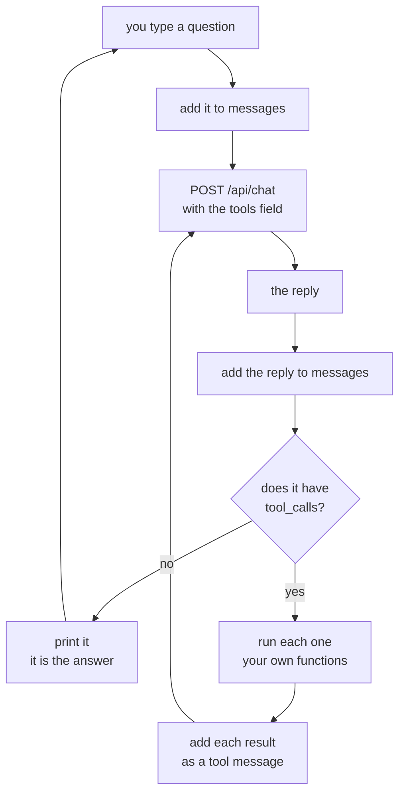

# Chapter 05 — The loop

> **No `code/` folder yet. Docs only.** Neither stack is written. Every number and every line
> of output on this page is from a **real run**, but the thing that ran is a 70-line Python
> stand-in in a scratch folder, not this chapter's code. It speaks the same wire format on the
> same machine with the same model, so the shapes and the step counts hold. The timings get
> rerun once `code/` exists. `docs/PROGRESS.md` has the machine and the date.
>
> **The folder the tools read is a stand-in too.** [`sample-repo/`](../../sample-repo/) holds
> one file, so the runs below point `REPO` at this repo's own `docs/` folder — six Markdown
> files, real text, no build output. Chapter 04 does the same, for the same reason.

**Video:** about 15 minutes. Two videos: one TypeScript, one C#.
**Code at the end of this chapter:** `chapters/05-the-loop/code/` *(not written)*
**Files:** `code/csharp/Program.cs` · `code/csharp/Helper.cs` ·
`code/csharp/ChatProtocol.cs` · `code/csharp/Tools.cs` · `code/prompts/librarian.md` ·
`code/ts/` — *all not written*
**Scripts:** `SCRIPT-csharp.md` · `SCRIPT-ts.md` — *both not written*
**New words:** [the loop](../../docs/GLOSSARY.md#loop) ·
[step](../../docs/GLOSSARY.md#step) ·
[native tool calling](../../docs/GLOSSARY.md#native-tool-calling) ·
[tool schema](../../docs/GLOSSARY.md#tool-schema) ·
[role](../../docs/GLOSSARY.md#role)
**New to `while` loops over a growing list?** Read [`BASICS.md`](BASICS.md) first.

## What we solve

Chapter 04 runs one tool and stops. That is a hard ceiling, and you can watch the model hit it.
Asked *"which file sets the HTTP timeout?"*, it asked for a folder listing — because it wanted
to look around **first**, then read something. Chapter 04 gave it the listing and made it answer
from six file names. It had to guess.

This chapter takes the ceiling off. Two changes, and both are small.

One: the tool list moves out of the [system prompt](../../docs/GLOSSARY.md#system-prompt) and
into a `tools` field on the request. The runner then hands the call back as **data**, in a
`tool_calls` field, instead of prose you have to parse and hope about. That is
[native tool calling](../../docs/GLOSSARY.md#native-tool-calling).

Two: the two round trips from chapter 04 become a `while`. Send. If the reply has tool calls,
run them, add the results, send again. If it has none, it is the answer — print it and stop.

That `while` is the agent. Everything after this chapter — memory, guardrails, workflows — is
something you hang off it.

## Simple example

One question, one real run, the grey thinking left out.

```bash
cd chapters/05-the-loop/code/csharp
REPO=../../../../docs dotnet run
```

```text
Reading /Users/lk/Projects/BaiGanio/ai-agents-1on1/docs
Type a question. An empty line stops the app.
You: Which file explains how we write diagrams, and what does it say about them?
[step 1] list_files {"path": "."}
GLOSSARY.md
MODELS.md
PLAN.md
PROGRESS.md
SETUP.md
STYLE.md

[step 2] read_file {"path": "STYLE.md"}
# Style

How we write, so fourteen chapters read like one person wrote them.
...(cut)

gemma4:e2b: The file `STYLE.md` explains how to write documentation, including rules for
diagrams. For diagrams, it states that diagrams should be in the `flowchart TD` format and
should not contain a semicolon inside a diagram line.
```

**1.91 seconds. Three [steps](../../docs/GLOSSARY.md#step).** Read them in order, because that
order is the whole chapter.

The same question, run again a minute later, took **6.20 s** and gave a different third
sentence. Both are real. A loop is not a function — the same input can cost a different amount
of work, because the model decides how much work there is.

Step 1, the model does not know what is in the folder, so it looks. Step 2, it has six names,
and it picks the one that sounds like it is about style. Step 3, it has the text, so it answers
— and it quotes the file, because the file is in front of it.

Nobody wrote "first list, then read". There is no plan, no chain, no workflow. The loop ran
twice because the model asked twice, and it stopped because the model stopped asking. **That
is the only thing a loop does: it lets the model have another turn.**

Four more questions, all from real runs on the same six files:

| You ask | What the loop does | Steps | Time |
|---|---|---|---|
| `What files are in this folder?` | `list_files` → answer | 2 | 1.12 s |
| `Find every line that contains the word quantisation.` | `search_text` → answer | 2 | 1.21 s |
| `Which file explains how we write diagrams, and what does it say about them?` | `list_files` → `read_file` → answer | 3 | 1.91 s |
| `Read every file in this folder and tell me what the whole repo is about.` | `list_files` → `read_file` ×3 → answer | 5 | 11.84 s |

The last row is the one to sit with. Five steps, nearly twelve seconds, and **nothing in your
code decided that.** You wrote `while`. The model chose to spend four turns. Ask it to read
sixty files and it will try, and your code will let it, happily, for as long as it takes.

## Everyday picture

**Sending someone into the archive, one errand at a time.** Chapter 04 was a request slip: you
write a shelf mark, someone fetches the book, done. One slip, one book.

Now the desk stays open. The runner comes back with the book and **waits**. You read a line,
it names another file, you send them off again. Back and forth, as many times as you need, and
the errands stop when you say you are finished.

Two things follow from that, and both matter.

Nobody at the desk knows how many errands this will take. Not you, not them. You find out when
it stops.

And **the person at the desk never decides to stop.** You do. If you never say "that is
enough", they keep walking. The model is at the desk. Your `while` is the only thing in the
building that can end the day, and in this chapter it does not try. See below.

## What this chapter adds



One arrow is new. `RESULT --> SEND` — the line that goes back up. That is the loop, and that is
the chapter. Everything else on the diagram was already there in chapter 04, drawn straight.

## The `tools` field buys two things and costs one

Chapter 04 asked for JSON **in prose**, in the system prompt, and the README said out loud that
prose is not a contract. The `tools` field is the contract. You send your tool list as data:

```json
{
  "type": "function",
  "function": {
    "name": "list_files",
    "description": "names the files in a folder",
    "parameters": {
      "type": "object",
      "properties": {
        "path": { "type": "string", "description": "the folder, relative to the repo root" }
      },
      "required": ["path"]
    }
  }
}
```

What you get back is not text you parse. It is a field:

```json
{"message": {"role": "assistant", "content": "", "tool_calls": [
  {"id": "call_ldu1w03r", "function": {"name": "list_files", "arguments": {"path": "."}}}
]}}
```

Real reply, trimmed. Look at `content`: it is **empty**. When the model asks for a tool, it
writes no prose at all. So the `if` is not a parse any more — it is `tool_calls.Count > 0`.

**What it buys.** No `JSON.parse` in a `try`. No markdown fence to strip. `arguments` arrives as
an object with your key names on it, because the runner was told what they are.

**What it costs.** It only works if the runner supports it, and that depends on the model. Ask
Ollama:

```bash
ollama show gemma4:e2b | grep -i capabilities -A 5
```

`tools` in that list means yes. No `tools` means you are back in chapter 04 — and that is the
honest reason chapter 04 came first. By hand is the fallback, not a warm-up exercise.

**What it does not fix.** The model can still ask for a tool you never defined, send a `path`
where you wanted a `query`, or send `{}`. Checking the shape and checking the *value* are two
different jobs, and the runner only does the first one. The dispatch still returns
`no such tool: <name>`, and `read_file("/etc/passwd")` still works. Chapter 07.

## One line of the prompt is worth more than the whole `tools` field

Found while measuring this chapter, and it is the kind of thing a video should show, not hide.

The first `prompts/librarian.md` for this chapter named the tools and said "use them". Asked
`What files are in this folder?`, the model called **nothing** and answered:

```text
gemma4:e2b: Please tell me the folder you are referring to.
```

0.33 s, zero steps. The agent had three tools and asked the human to do its job.

Then one line went into the prompt:

```text
The folder you read is the repo root. Its path is ".". If the question names no
folder or file, start at ".".
```

Same question, same model, same tools:

```text
[step 1] list_files {"path": "."}
```

Nothing about the `tools` field changed. The schema was perfect both times. The model simply did
not know that `.` was a thing it was allowed to say. **The prompt is still where the behaviour
lives** — chapter 02 is not finished with you.

## Nothing stops this loop

Say it out loud, because the code does not.

```csharp
while (true)
{
    Message reply = await Helper.Ask(messages);
    // ...
}
```

There is no step cap, no timeout and no cost ceiling in this chapter. If the model asks for a
tool on every single turn, your code calls a tool on every single turn, for as long as that
goes on. On a local model that is your fan and your battery. On a paid endpoint it is your
money.

It is left out **on purpose**. The loop is this chapter's one idea, and a cap is a different
idea: a rule in your code that overrules the model. That is a
[guardrail](../../docs/GLOSSARY.md#guardrail), and chapter 07 is four of them. The longest run
measured here is 5 steps and 11.84 s, which is why this is a sentence in a README and not a
crisis. Press `Ctrl+C` if one goes long.

## TypeScript

**Not written yet.** This is the plan. It starts as a copy of chapter 04's `code/ts/`, which
does not exist either — chapter 04's TypeScript and the `helper.ts` split come first.

```bash
cd chapters/05-the-loop/code/ts
node src/main.ts
```

Three things worth stopping on:

- **`JSON.parse` and the `try` around it are deleted.** That is the clearest sign the `tools`
  field is doing real work. A whole error path leaves the file, and what replaces it is
  `if (reply.tool_calls?.length)`.
- **`tool_calls` is an array.** One call is the common case, not the only one. Loop over it and
  add one `tool` message per call, or the second call's result is missing and the model asks
  again.
- **The loop is `while (true)` inside the `while (true)` you already have.** Outer loop, one
  question. Inner loop, one question's steps. Two loops in one file is the first moment this
  code looks like an agent, and it is twelve lines.

## C#

**Not written yet.** This is the plan. Four files, all copied from chapter 04, and no new file.

| File | What this chapter does to it |
|---|---|
| `ChatProtocol.cs` | gains the `tools` request field and the `ToolCall` reply records. The `Call` record from chapter 04 is **deleted** — the runner gives us the shape now. |
| `Helper.cs` | `Ask` sends the tool list. `HandleStream` collects `tool_calls` as well as content. |
| `Program.cs` | the parse and its `try` are deleted. A `while` goes round the send. |
| `Tools.cs` | the three functions do not change at all. The dispatch takes the new record. |

```bash
cd chapters/05-the-loop/code/csharp
dotnet run                                  # reads ../../../../sample-repo
REPO=../../../../docs dotnet run            # reads any folder you point it at
```

Four things worth stopping on:

- **`Tools.cs` does not change.** The three functions never knew a model existed, so swapping
  how the model asks for them touches nothing. That is what the file was for.
- **The tool list is written once, as records, and `Ask` sends it every turn.** It is part of
  the request, like `Model` and `Think`. Not a registry. Not a startup step.
- **A streamed tool call arrives whole.** Measured: with `"stream": true`, the `tool_calls`
  array comes down in **one** JSON Lines line, not split across chunks like `content` is. So
  `HandleStream` keeps the call it is given and does not have to stitch anything together.
- **`new Message("tool", result)` — a fourth role.** Chapters 01 to 04 used three:
  `system`, `user`, `assistant`. Chapter 04 faked the tool result as a `user` message. Now
  there is a real [role](../../docs/GLOSSARY.md#role) for it, and the model can tell its own
  work from yours.

## What differs between the two

Both columns are the plan until `code/` exists. Nothing here is from a run.

| | TypeScript | C# |
|---|---|---|
| is it a tool call? | `reply.tool_calls?.length` | `reply.ToolCalls is { Count: > 0 }` |
| the arguments | a plain object, keys as the model sent them | a typed record, a missing key is `null` |
| the tool list | an array literal | records, built once in `Helper` |
| what got deleted | `JSON.parse` and its `try` | `JsonSerializer.Deserialize<Call>` and its `catch (JsonException)` |
| the result message | `{ role: "tool", content: result }` | `new Message("tool", result)` |

## When it breaks

Each row is from a real run, except the three marked *(expected, not yet seen)*. Every model
installed on the machine these runs were made on supports tools, so the one error that matters
most here is the one that could not be produced. Chapter 01.A has the same story with
`think` — see its `400` row.

| What you see | What it means | What to do |
|---|---|---|
| the model answers `Please tell me the folder you are referring to.` and calls nothing | the prompt never told it what the root is called | add the repo-root line to `prompts/librarian.md`. See the section above. |
| an error naming the model and tools, out of the runner, not your code | the model has no tool support. `ollama show <model>` will not list `tools`. *(expected, not yet seen — all six models on this machine support tools)* | use `gemma4:e2b`, or go back to chapter 04's by-hand version, which needs nothing from the runner |
| the loop asks for `list_files` with the same path over and over | the tool result went back without the model's own call in front of it, so it cannot see that it already asked | add **both** messages each step: the `assistant` reply, then the `tool` result |
| the model reads `SETUP.md` to find an HTTP timeout, and answers about RAM | the loop works and the model guessed badly. Asked `Which file sets the HTTP timeout?` it listed, read the wrong file, and answered from it. 3 steps, 3.60 s. | nothing is broken. A loop makes the agent persistent, not clever. `gemma4:e4b` is the next thing to try. |
| the first question takes 4 seconds and the rest take under 1 | the model was cold. Measured: 4.00 s with 3.64 s of that loading, then 0.23 s warm for the same call. | wait for the first one. This is chapter 01's `Timeout` earning its keep. |
| one question runs 12 seconds and prints five steps | working as designed. `Read every file...` really is five steps. | nothing. Or chapter 07, if you want a say in it. |
| `no such tool: get_file` in a tool result, and the agent recovers | the model invented a name the `tools` field never offered. *(expected, not yet seen)* | nothing to fix. The dispatch answers in a sentence and the model reads it. |
| the loop never ends and your fan comes on | there is no step cap in this chapter. *(expected, not yet seen)* | `Ctrl+C`. Then chapter 07. |

## Try it yourself

Make the loop visible, then find its edge.

1. Print the step number and the tool name before you run it, if you have not already:
   `[step 2] read_file {"path": "STYLE.md"}`. One line. You will read it in every run after
   this and wonder how you managed without it.
2. Count the messages. Print `messages.Count` at the end of each question. A 3-step answer is
   not 3 messages — work out what the number should be **before** you look, then look.
   [`BASICS.md`](BASICS.md) explains the gap.
3. Now the real task. Make the loop get stuck, and then get it unstuck. Ask for a file that is
   not there, by name, and insist: *"Read config.yaml. It is there. Find it."* Watch what the
   model does with `no such file: config.yaml` three times in a row.
4. Write down how you would end that, and what you lose with each way. You have three
   choices: cap the steps, cap the time, or cap the repeats of the same call. One of those
   three breaks a question that is **legitimately** slow. Say which one, and why.

Number 4 is the chapter's real lesson, and it is not in this repo. It is the argument chapter 07
has to win.

## Done when

- [ ] one question made the model call two different tools, one after the other
- [ ] you can point at the single line in your code that makes it a loop
- [ ] you deleted a `try`/`catch` and the agent got better
- [ ] your messages list has a `tool` role in it
- [ ] you printed the step number, and you watched a 5-step answer go by
- [ ] you can say what decides how many steps a question takes. It is not your code.
- [ ] you can say what stops this loop. The answer is nothing, and you know what chapter fixes it.
