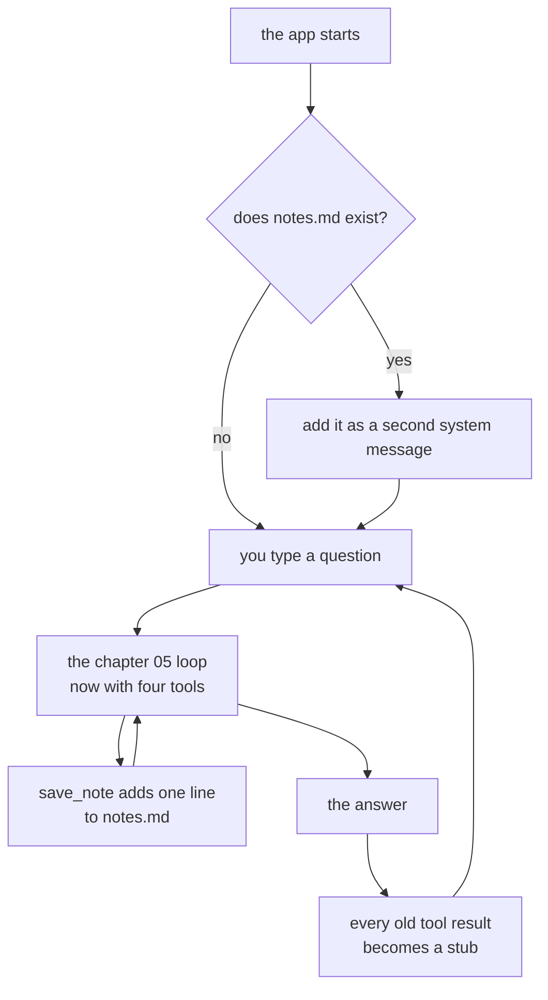

# Chapter 06 — Memory

> **C# is written and run. TypeScript is not.** `code/csharp/` builds with no warnings, and
> every number and every line of output on this page comes from a real run of it on a real
> machine, or from a curl run that says so. `code/ts/` does not exist yet, so the TypeScript
> section describes the code that gets typed and its file links are dead. Neither camera script
> is written.
>
> **The folder the tools read is a stand-in.** [`sample-repo/`](../../sample-repo/) holds one
> file, so the runs below point `REPO` at this repo's own `docs/` folder, the same as chapters
> 04 and 05. Every example gets rerun against `sample-repo/` once it exists.

**Video:** about 15 minutes. Two videos: one TypeScript, one C#.
**Code at the end of this chapter:** `chapters/06-memory/code/`
**Files:** [`code/csharp/Program.cs`](code/csharp/Program.cs) ·
[`code/csharp/Tools.cs`](code/csharp/Tools.cs) ·
[`code/csharp/Helper.cs`](code/csharp/Helper.cs) ·
[`code/csharp/ChatProtocol.cs`](code/csharp/ChatProtocol.cs) ·
[`code/prompts/librarian.md`](code/prompts/librarian.md) · `code/ts/` *(not written)*
**Scripts:** `SCRIPT-csharp.md` · `SCRIPT-ts.md` — *both not written*
**New words:** [memory](../../docs/GLOSSARY.md#memory) ·
[stub](../../docs/GLOSSARY.md#stub) ·
[notes file](../../docs/GLOSSARY.md#notes-file)
**New to files that outlive the app?** Read [`BASICS.md`](BASICS.md) first.

## What we solve

Chapter 05 has two memory problems, and they pull in opposite directions.

One: it remembers too much. Every file it reads stays in the message list, and the whole list
goes to the model on every step of every question after that. Read one big file and each later
question pays for it again.

Two: it remembers too little. Quit the app and the list is gone. Tell it your name, restart, and
it has never met you.

This chapter fixes both. **Short memory** — the message list — gets smaller after each answer:
old tool results become a one-line [stub](../../docs/GLOSSARY.md#stub). **Long memory** is a
[notes file](../../docs/GLOSSARY.md#notes-file): a fourth tool, `save_note`, adds a line to it,
and the next run reads it back in.

## Simple example

Two runs of the app, one after the other. The middle of the file is cut, and the grey is
flattened to plain text. Nothing else is touched.

```bash
cd chapters/06-memory/code/csharp
REPO=../../../../docs dotnet run
```

```text
Reading /Users/lk/Projects/BaiGanio/ai-agents-1on1/docs
Type a question. An empty line stops the app.
You: Remember that my name is Lyuben.
gemma4:e2b:  [366 tokens in]
[step 1] save_note User's name is Lyuben.
saved

gemma4:e2b:  [399 tokens in]

You: Which file explains how we write diagrams, and what does it say about them?
gemma4:e2b:  [435 tokens in]
[step 1] list_files .
GLOSSARY.md
MODELS.md
PLAN.md
PROGRESS.md
SETUP.md
STYLE.md

gemma4:e2b:  [486 tokens in]
[step 2] read_file GLOSSARY.md
# Glossary
...(cut)

gemma4:e2b: The file `GLOSSARY.md` explains terms used in the course. It defines terms like
'agent', 'context window', 'tool', and 'prompt'. It details what these terms mean in the
context of the course material. [2270 tokens in]

You: What files are in this folder?
gemma4:e2b:  [576 tokens in]
[step 1] list_files .
...(six names)

gemma4:e2b: The files in this folder are GLOSSARY.md, MODELS.md, PLAN.md, PROGRESS.md,
SETUP.md, and STYLE.md. [627 tokens in]
```

**7.39 seconds for all three questions, including `dotnet run`.** Then the app was closed, and
started again:

```text
You: What is my name?
gemma4:e2b: Your name is Lyuben. [383 tokens in]
```

**2.07 seconds, and no tool call.** The note came from `code/notes.md`, a file the first run
wrote:

```text
- User's name is Lyuben.
```

Read the `tokens in` numbers in order. That is the size of everything the model read for that
step. The glossary pushes it to **2270**. The next question starts at **576**, because the
glossary text is gone. The call that read it is still there.

Run the same three questions with the drop turned off, and the next question starts at
**2271**. The third question ends at **2593** instead of **812**. That is the whole of short
memory, in two numbers.

The answer to the diagram question is weak. The model read the glossary, not `STYLE.md`. That
is chapter 05's "persistent, not clever", and memory does not fix it.

## Everyday picture

**Your desk and your notebook.** While you work on a job, the papers you need are on the desk.
When the job is done, you put them back on the shelf. You keep a slip that says which shelf.
Need one again? You go and get it. Leave everything on the desk, and the next job starts under a
pile.

The notebook is different. It goes home with you. You write one line in it when something is
worth keeping — a name, a rule. Tomorrow morning you read it before you start.

Two things follow. The desk is cleared by **you**, not by the person at the desk. And nothing
goes in the notebook unless someone **writes** it. Saying "I will remember" is not writing.

## What this chapter adds



Two boxes are new: the notes going in at the top, and the stubs going in at the bottom. The loop
in the middle is chapter 05's, with one more tool on its list.

## Why we drop old tool results

The model remembers nothing between calls. Chapter 01 said so, and chapter 05 showed what it
costs: the list is the memory, and the whole list is sent every time. A tool result is the
biggest thing in it. One `read_file` of the glossary is about 1800 tokens. Every step after it
pays those 1800 tokens again, on every question, until you quit.

So after each answer, `Program.cs` walks the list and replaces the text of every `tool` message
with one line:

```text
[dropped. Call the tool again to see it.]
```

Three choices hide in that, and each one is on purpose.

- **After the answer, not during.** In the middle of a question the model needs the file it
  just read. That is why it read it. Once the answer is on screen, the file has done its job.
- **Only the text goes. The call stays.** The `assistant` message that asked for
  `read_file GLOSSARY.md` is untouched. So the model can still see what it read, and the `tool`
  message still follows its call, as chapter 05 says it must.
- **The stub says what to do.** Asked a follow-up — *"What does that same file say a stub
  is?"* — the model called `read_file GLOSSARY.md` again, and answered from the fresh copy. The
  count went from 514 to 2298 for that one step, then back down.

What this costs: a follow-up question about the same file pays one more tool call. That is the
trade. One call when you need it, against the whole file on every step when you do not.

## The model says it remembers, and saves nothing

This is the finding the chapter is built on. Measured by curl on 2026-10-29, `gemma4:e2b`,
`save_note` in the `tools` field, three runs per question.

With no line about it in the prompt, `save_note` was called **0 times in 12**, across four
questions like *"Remember that my name is Lyuben."* Every answer was some form of:

```text
Understood, Lyuben. I will remember that for our session.
```

Nothing was saved. The model did not lie on purpose. It wrote the words a person would say,
and saying is all a model can do. Only a tool call writes a file.

One line in [`prompts/librarian.md`](code/prompts/librarian.md) fixed it:

```text
When the user asks you to remember something, call save_note with one short sentence.
```

With that line: **15 of 15**. Even *"My name is Lyuben."*, with no word "remember" in it, saved
`User's name is Lyuben.` And *"What files are in this folder?"* still called `list_files`, 3 of
3, so the line did not make it save everything.

Chapter 05 found the same thing with the repo root. **A tool in the `tools` field is a tool the
model may use. The prompt is where you say when.**

## Where the notes go matters

The first version of the code glued the notes onto the end of the system prompt. The next run,
asked *"What is my name?"*, said:

```text
I do not have a record of your name. Can you please tell me your name so I can remember it?
```

The note was in the request. Measured by curl, five runs each, all with the `tools` field:

| Where the notes sit | Name right |
|---|---|
| at the end of the system message | 0 of 5 |
| at the end, under a `##` heading | 1 of 5 |
| at the end, with *"They are facts. Answer from them with no tool"* | 0 of 5 |
| at the top of the system message | 5 of 5 |
| **as a second system message** | **5 of 5** |

With no `tools` field at all, even the first row was 5 of 5. So the tool list, sent after the
system text, pulls the model away from what was written last. We do not know more than that.

The code uses the last row. Long memory is then one more message, and you can see it in the
list. The real code, run four times: four times *"Your name is Lyuben."*

## TypeScript

**Not written yet.** This is the plan. It starts as a copy of chapter 05's `code/ts/`, which
does not exist either — the `helper.ts` split comes first.

```bash
cd chapters/06-memory/code/ts
node src/main.ts
```

Three things worth stopping on:

- **The drop is `messages = messages.map(...)`, or a loop that sets `content` in place.** A
  TypeScript object is not a record, so both work. Pick one and say why.
- **`prompt_eval_count` arrives with that name.** TypeScript reads the field as Ollama wrote
  it. No attribute, no trap.
- **`appendFileSync` and `existsSync`.** Both are in `node:fs`. No package.

## C#

Four files, all copied from chapter 05. No new file. One prompt line.

| File | Lines | What this chapter does to it |
|---|---|---|
| [`Program.cs`](code/csharp/Program.cs) | 97 | reads `notes.md` into a second system message. Drops old tool results after each answer. Prints the note in the step line. |
| [`Tools.cs`](code/csharp/Tools.cs) | 127 | gains the `save_note` schema, its `case`, and `SaveNote`. The other three tools do not change. |
| [`Helper.cs`](code/csharp/Helper.cs) | 148 | gains `NotesPath`. `HandleStream` prints `[N tokens in]` from the last line of the stream. |
| [`ChatProtocol.cs`](code/csharp/ChatProtocol.cs) | 55 | `ChatResponse` gains `PromptEvalCount`. `ToolArguments` gains `Text`. |
| [`prompts/librarian.md`](code/prompts/librarian.md) | 14 | gains the `save_note` line |

```bash
cd chapters/06-memory/code/csharp
REPO=../../../../docs dotnet run                 # notes go to ../notes.md
NOTES=/tmp/other.md REPO=../../../../docs dotnet run   # any notes file you like
```

**34 new code lines** (253 against chapter 05's 219), against the ~50 guide in
[`PLAN.md`](../../docs/PLAN.md). `dotnet build` is clean, 0 warnings. Four things worth stopping
on:

- **`messages[i] = messages[i] with { Content = stub };`** A record cannot change. `with` makes
  a copy with one field different, and the copy goes back in the same place. The role and the
  order stay.
- **`[property: JsonPropertyName("prompt_eval_count")]`.** Chapter 05's trap, a second time.
  Without it the camelCase policy looks for `promptEvalCount`, finds nothing, and the count is
  `null` on every reply. Nothing fails. The number is not printed.
- **`notes.md` lives next to `prompts/`, outside `REPO`.** So `list_files` never shows the agent
  its own notes as if they were part of the repo. `NOTES` moves it, like `REPO` and `MODEL`.
  `.gitignore` keeps every chapter's `notes.md` out of git.
- **`SaveNote` is the first tool that writes.** It can only add a line, to one file the model
  cannot name. Chapter 07 makes it ask you first.

The token count is honest. Measured by curl: the same request twice reported 924 and 924, so
Ollama counts the whole prompt even when it reuses its cache.

## What differs between the two

The C# column is from the code. The TypeScript column is the plan, until `code/ts/` exists.

| | TypeScript | C# |
|---|---|---|
| the drop | set `content` on the object, or `map` | `with` makes a new record, put back at `i` |
| the token count | `chunk.prompt_eval_count`, as it arrives | `PromptEvalCount`, plus a `JsonPropertyName` attribute |
| the note text | `args.text` | `ToolArguments.Text`, `null` for the other three tools |
| the file | `appendFileSync`, `existsSync` | `File.AppendAllText`, `File.Exists` |

The second row is the same C# tax as chapter 05's `tool_calls`.

## When it breaks

Each row is from a real run.

| What you see | What it means | What to do |
|---|---|---|
| `Understood, Lyuben. I will remember that for our session.` and no `[step 1] save_note` line | the prompt has no `save_note` line. The model said it. Nothing wrote it. No `notes.md` exists. | add the line to [`prompts/librarian.md`](code/prompts/librarian.md). See above. |
| the next run says `I do not have a record of your name.` and `notes.md` has your name in it | the notes were glued onto the end of the system message | add them as a second system message. See "Where the notes go matters". |
| no `[N tokens in]` after any reply, and no error | `PromptEvalCount` has no `JsonPropertyName` attribute, so it is `null` every time | the attribute in `ChatProtocol.cs` |
| `[step 1] save_note ...` and `saved`, then the model prints its name and nothing else | the note is saved. The model chose to say nothing after it. Once in the two real runs that saved a note. | nothing is broken. `cat ../notes.md` to check. |
| a follow-up question about a file calls `read_file` on it again | working as designed. The text was dropped after the last answer. | nothing. It is one call. |

## Try it yourself

Give yourself a way to save a note the model cannot skip.

1. Add a command: a line that starts with `/remember ` is not sent to the model at all. Your
   code writes the rest of the line to the notes file, prints `saved`, and waits for the next
   question. Where in `Program.cs` does that check go, and why there?
2. Restart and ask for the note back. Does it work as well as a note the model saved? It
   should. Say why.
3. Now the real question. You have two ways to save a note: the model picks, or you do. Write
   one sentence for when each one is the right choice. Chapter 08 is about that question for a
   whole workflow.

The answer is not in this repo.

## Done when

- [ ] you watched `[N tokens in]` drop at the start of a question, and you can say what left
- [ ] you can say why the drop happens after the answer and not during
- [ ] you saw the model say "I will remember" and save nothing
- [ ] one prompt line made it call `save_note`
- [ ] you closed the app, started it again, and it knew your name
- [ ] you can say why the notes are a second system message, and not the end of the first
- [ ] `notes.md` is not in `git status`
