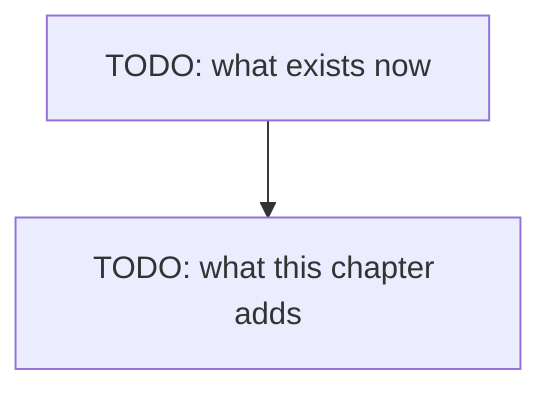

# Chapter 06.A — Writing

> **Not written yet.** This is the skeleton. See [`docs/PLAN.md`](../../docs/PLAN.md) for where
> this chapter sits, and [`docs/STYLE.md`](../../docs/STYLE.md) for how to fill it in.

**Video:** about 12 minutes. Two videos: one TypeScript, one C#.
**Code at the end of this chapter:** `chapters/06.A-writing/code/` *(not started)*
**New words:** TODO — link each to [`GLOSSARY.md`](../../docs/GLOSSARY.md)

## What we solve

The Librarian can read the docs in a folder, but it cannot change them. This chapter gives it
three tools that do: `write_file`, `append_file` and `delete_file`. They work inside `REPO`.
Nothing stops them yet. Chapter 07 adds the guards.

## Simple example

TODO: one concrete thing the viewer sees happen on screen. From a real run.

## Everyday picture

TODO: one picture from normal life that carries the idea.

## What this chapter adds

## Nothing guards these tools

TODO: say it out loud, with a real run. `delete_file` takes a whole folder. `git restore
sample-repo/` brings it back. Chapter 07 fixes this.

## TypeScript

TODO

## C#

TODO

## What differs between the two

TODO: or "nothing worth a sentence", which is also an answer.

## When it breaks

| What you see | What it means | What to do |
|---|---|---|
| TODO: copied from a real run | | |

## Try it yourself

TODO: one small task, 10-20 minutes, that changes the code.

## Done when

- [ ] TODO
