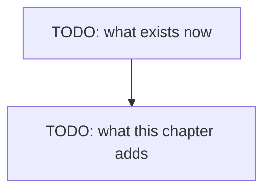

# Chapter 07 — Guardrails

> **Not written yet.** This is the skeleton. See [`docs/PLAN.md`](../../docs/PLAN.md) for where
> this chapter sits, and [`docs/STYLE.md`](../../docs/STYLE.md) for how to fill it in.

**Video:** about 15 minutes.
**Code at the end of this chapter:** `git checkout 07-TODO-tag`
**New words:** TODO — link each to [`GLOSSARY.md`](../../docs/GLOSSARY.md)

## What we solve

Five guards (decision 54). A step cap, a timeout for one whole question, a repeat check, a
path allow-list, and a yes before anything risky. The risky things are two tools from chapter
06.A: `write_file` and `delete_file`. `append_file` runs with no ask, because it cannot lose
text. A path must stay inside `REPO`, and must not be `REPO` itself.

## Simple example

TODO: one concrete thing the viewer sees happen on screen.

## Everyday picture

TODO: one picture from normal life that carries the idea.

## What this chapter adds

## TypeScript

TODO

## C#

TODO

## What differs between the two

TODO: or "nothing worth a sentence", which is also an answer.

## When it breaks

| What you see | What it means | What to do |
|---|---|---|
| TODO: copied from a real run | | |

## Try it yourself

TODO: one small task, 10-20 minutes, that changes the code.

## Done when

- [ ] TODO
