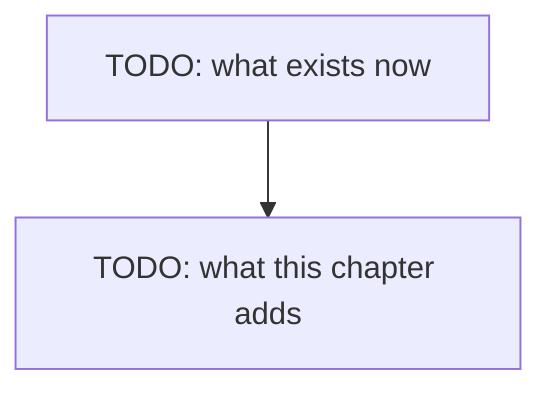

# Chapter 08 — Workflows

> **Not written yet.** This is the skeleton. See [`docs/PLAN.md`](../../docs/PLAN.md) for where
> this chapter sits, and [`docs/STYLE.md`](../../docs/STYLE.md) for how to fill it in.

**Video:** about 15 minutes.
**Code at the end of this chapter:** `git checkout ch08-workflows`
**New words:** TODO — link each to [`GLOSSARY.md`](../../docs/GLOSSARY.md)

## What we solve

Job ads ask for "agentic workflows". The term means several model calls wired together. We
build three with the Librarian's tools: a chain (one step feeds the next), a router (one call
picks who answers), and a checker (one call grades another and asks for a retry). Then the
question that matters: should your code pick the path, or should the model?

## Simple example

TODO: one concrete thing the viewer sees happen on screen.

## Everyday picture

TODO: one picture from normal life that carries the idea.

## What this chapter adds

## TypeScript

TODO

## C#

TODO

## What differs between the two

TODO: or "nothing worth a sentence", which is also an answer.

## When it breaks

| What you see | What it means | What to do |
|---|---|---|
| TODO: copied from a real run | | |

## Try it yourself

TODO: one small task, 10-20 minutes, that changes the code.

## Done when

- [ ] TODO
