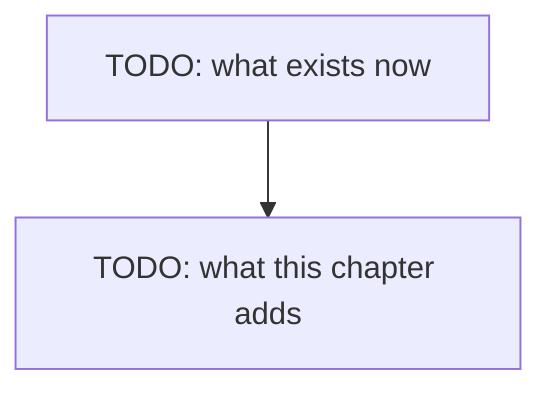

# Chapter 10 — Choosing a model

> **Not written yet.** This is the skeleton. See [`docs/PLAN.md`](../../docs/PLAN.md) for where
> this chapter sits, and [`docs/STYLE.md`](../../docs/STYLE.md) for how to fill it in.

**Video:** about 15 minutes.
**Code at the end of this chapter:** `git checkout ch10-choosing-a-model`
**New words:** TODO — link each to [`GLOSSARY.md`](../../docs/GLOSSARY.md)

## What we solve

Every model so far ran on one Mac. Yours may have 16 GB or 64 GB. We put five models side by
side: how big each file is, how much RAM each needs at 16K, 32K, 64K and 128K of context, how
fast each answers, and which ones can see images. Gemma 4 has vision. Ornith does not. Then
`scripts/measure.ts` gives you the same table for your own machine. The full table is in
[`docs/MODELS.md`](../../docs/MODELS.md).

## Simple example

TODO: one concrete thing the viewer sees happen on screen.

## Everyday picture

TODO: one picture from normal life that carries the idea.

## What this chapter adds

## The comparison

TODO: the table from `docs/MODELS.md`, and a vision demo with a screenshot.

## When it breaks

| What you see | What it means | What to do |
|---|---|---|
| TODO: copied from a real run | | |

## Try it yourself

TODO: one small task, 10-20 minutes, that changes the code.

## Done when

- [ ] TODO
